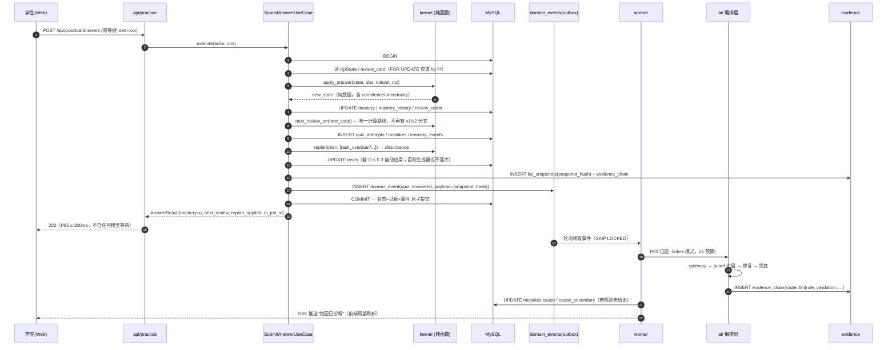

# 学迹 XUEJI · 系统架构与长期发展规划

> 版本：v1.0 ｜ 日期：2026-11 ｜ 定位：**团队蓝图**（不是答辩稿，是可以照着排期执行的工程文档）
> 依据：`docs/prd_v2_extract.txt`（PRD v2.0，1885 行）＋ 对 `backend/`、`frontend/` 的实测代码审读
> 读者：后端、前端、算法、测试、运维、产品负责人

---

## 0. 一页读懂

### 0.1 三句话判断

1. **现有系统是"能跑通、设计有骨架、但商用会出事故"的单体。** 代码量已达后端 3.27 万行 / 52 张表 / 201 个端点 / 871 个测试用例，架构分层（规则层 / 模型层 / 校验层）是真实存在的，不是 PPT；但有 10 处结构性风险会在收费后变成数据事故或合规事故，其中 3 处是致命的（见 1.3）。
2. **不应该拆微服务，应该拆"负载曲线"。** 系统里真正互相冲突的不是业务域，而是三种完全不同的负载：交互读（P95 < 300ms）、AI 长任务（秒级到分钟级、外部依赖、要钱）、批量重算（CPU 密集、可延迟）。按业务域拆服务只会换来分布式事务；按负载曲线拆出 worker，收益是立竿见影的。
3. **规则内核是这家公司唯一的技术护城河，必须当成"产品"来治理。** "规则管事实、模型管表达"是学迹区别于通用大模型产品的全部理由。当前规则以函数散落在 `services/rules.py`、`mastery_service.py`、`flashcards.py`、`planner.py` 中，并有两条互相矛盾的复习日期计算路径——这会让"可复算"这个承诺在第一次规则升级时失效。把它抽成**零 IO 纯函数库 + 版本化规则集**，是本规划的第一优先级。

### 0.2 五个必须现在拍板的决策

| # | 决策 | 选择 | 明确放弃 | 何时可以改 |
|---|---|---|---|---|
| D1 | 服务形态 | **模块化单体**，一个代码库、一个部署单元；P2 只拆 AI 编排与计算 worker | 微服务、服务网格、K8s（P2 前） | P3 若组织 > 20 人再评估 |
| D2 | 规则内核 | 抽为 `kernel/` 零依赖纯函数包，带 `ruleset_version`，唯一计算真值来源 | 规则作为服务（性能与一致性都不允许） | 不再改 |
| D3 | AI 调用 | 每条提示词必须声明执行模式（inline / deferred / job）与降级语义；**规则结果先返回，AI 内容后补齐** | 请求内同步等待模型（现状） | 不再改 |
| D4 | 数据增长 | 追加型表（证据/审计/事件）**先分区后归档**，不做过早分库 | 分库分表中间件、TiDB、向量库 | 见 3.6 触发门槛 |
| D5 | 多租户 | 共享库共享表 + `tenant_id` + **强制行级过滤**；大客户竖切独立库 | schema-per-tenant（迁移成本不可控） | P3 评估 |

### 0.3 演进路线一句话

```
模块化单体（现在）→ 单体 + 独立 worker（P1）→ 拆 AI 编排 / 计算两个服务 + 读写分离（P2）→ 平台化 + 租户竖切（P3）
```

四个阶段的划分依据不是功能多少，而是**每一阶段解决一类会阻断商业化的约束**：P0 解决"数据不能丢、结论必须可复算"，P1 解决"响应时间与多租户"，P2 解决"故障隔离与规模"，P3 解决"生态与开放"。

---

## 1. 现状评估

### 1.1 实测事实（不是文档描述，是代码里数出来的）

| 维度 | 实测值 | 说明 |
|---|---|---|
| 后端规模 | 136 个文件 / **32,729 行**（`app/`） | 另 tests 60 文件 / 17,205 行 |
| API 层 | 45 个 router 模块 / **201 个端点** / 5,989 行 | `auth.py` 单文件 594 行，职责已过载 |
| 服务层 | 76 个 service 模块 / **20,813 行** | 最大 `reverse_teaching.py` 1,246 行 |
| 数据模型 | **52 张表** / 924 行 | 含 v2 的 8 张新表，已落地 |
| 测试 | **871 个测试函数** | conftest 强制 SQLite + 内存缓存 + LLM 置空，隔离设计良好 |
| 前端 | 49 个 `.vue` / **18,149 行** / `style.css` **10,417 行** | Vue 3 + 自研 Rollup，无 TS，无状态管理库 |
| 部署单元 | **1 个**（FastAPI 同源托管前端静态产物） | `Dockerfile` 两阶段 + `docker-compose`（MySQL/Redis/app） |
| 异步能力 | 全库仅 **1 处** `asyncio.create_task`（`quiz.py` 题库预热） | 无队列、无 worker、无定时任务框架 |
| 进程内状态 | `llm.py` 计数器/熔断/缓存、`cache.py` 内存字典 | 多副本即失真 |
| 租户模型 | **无**。`User.school` 是字符串，`classes` 只有 `owner_id` | 无 `tenant_id`、无 `org_id` |
| 鉴权 | JWT（HS256）+ `jti` 会话表 + 撤销 | 会话撤销做得比多数商业产品好；token 存 localStorage |

### 1.2 已经做对、这次演进**不要动**的东西

写这份文档的前提是承认现有代码的价值。以下六点是有意设计出来的资产，任何重构都应当保留其语义：

1. **降级链路是完整且分层的**：模型主通道 → 备通道 → 熔断 → 规则兜底；DB RDS → SQLite；缓存 Redis → 内存。并且每一级都在"系统接入"页如实标注。这是产品信任感的来源，不是技术债。
2. **"规则先算、模型只表达"已经落到代码结构里**：`services/rules.py` 是纯函数、`services/validator.py` 做七层校验、`app/llm.py` 只管通道、`app/prompts/` 管版本。这套分层是对的，问题只在于**边界没有强制**，不在于方向错了。
3. **提示词工程已经有工程化的雏形**：`prompts/library.py` + `prompt_versions` 表 + `prompt_hash` + `PROMPT_VERSION_PIN`。19 条提示词、档位、温度、超时都在代码里，这是很难补的资产。
4. **测试规模与隔离设计**：871 个用例、conftest 三重隔离（DB/缓存/LLM），意味着重构时有安全网。这决定了我们**可以**做 1.4 的渐进式重构，而不必重写。
5. **信息架构已经为商业化做了准备**：`frontend/src/sections.js` 的 `audience: core / campus / internal` 分级，把"个人版可见 / 校园 B 端可见 / 内部工具"分离了。班级版上线时不需要重排导航。
6. **会话与账号安全做得细**：`jti` + `auth_sessions` 表 + 改密踢下线 + 导出/注销接口（`GET/DELETE /api/auth/me`）。个保法的"可携带、可删除"在接口层已具备。

### 1.3 十个结构性风险（按"收费后会出多大事"排序）

> 判定标准：是否会导致**数据丢失 / 结论错误 / 合规处罚 / 客户流失**。纯代码风格问题不进这张表。

| # | 风险 | 代码证据 | 商用后果 | 处置阶段 |
|---|---|---|---|---|
| **R1** | **生产环境静默降级到本地 SQLite** | `database.py: resolve_database()` 探活失败即切 `sqlite-fallback`，仅打 warning | RDS 抖动 30 秒 → 用户写入落到容器本地文件 → 重启即丢；多副本各自写各自的库 → **数据分叉**。这是收费产品的灭顶之灾 | **P0** |
| **R2** | **启动即 DDL，无迁移版本** | `main.py: ensure_schema()` 启动时 `create_all` + `ALTER TABLE ADD COLUMN` | 滚动发布时多副本并发 DDL → MySQL 元数据锁 → 发布卡死 / 表结构漂移，且无回滚路径 | **P0** |
| **R3** | **同一事实两条计算路径（复习日期）** | `mastery_service.apply_answer()` 用 `next_review_date(correct, review_stage)`（v1 固定 1/2/4/7/15 档）；`flashcards.py` / `planner.py` 用 `stability + retention`（v2 遗忘曲线） | `mastery.next_review_at` 与 `review_cards.next_review` 会给出**不同的复习日**。LSV 里读哪个取决于调用链 → "每个数字都能复算"直接破功，且答辩/审计时无法自证 | **P0** |
| **R4** | **证据链 snapshot_id 可能是伪造的** | `evidence.py: record_evidence()` 在调用方未传时 `setdefault("snapshot_id", f"ev_{时间戳}_{uuid}")`；真实 LSV 快照 id 形如 `lsv_20261109_ab12cd34` | 证据表里的 `snapshot_id` 与 `lsv_snapshots.snapshot_id` **无法 JOIN**（前缀都不同）。对外承诺"每个 AI 判断可还原输入"，实际还原不了 | **P0** |
| **R5** | **AI 长任务在请求内同步阻塞** | 出题/周报/评审团/回放都在 HTTP 请求里等模型，超时 12–50s；前端 `LONG_TIMEOUT = 180000` | 用户关页面 = 任务白花钱；超时 = 直接失败，无重试、无断点；并发上来后线程池（`sync def` 路由跑在 anyio 线程池）被模型等待打满，**连带拖垮普通读接口** | **P1** |
| **R6** | **无租户模型，班级聚合靠手工 JOIN** | `classes` / `class_members` 只有 `owner_id` 和 `role`，所有查询手写 `user_id in (...)` | 一处漏写就是越权（教师看到别班、家长看到别家孩子）。B 端客户安全评审会直接卡住签约 | **P1** |
| **R7** | **进程内计量与熔断在多副本下失真** | `llm.py`: `self.calls / _consecutive_failures / _open_until / _cache` 全是实例属性 | 3 副本时：成本统计 ÷3 偏低、熔断各自为政（副本 A 已熔断，B 仍在打挂掉的通道）、语义缓存命中率随副本数线性衰减 | P1 |
| **R8** | **JWT 存 localStorage，有效期 7 天** | `frontend/src/api.js: authToken()` 读 `localStorage.xueji_session`；`ACCESS_TOKEN_EXPIRE_MINUTES=10080` | 任一 XSS（含第三方脚本）即可窃取 7 天有效凭据。虽有 `jti` 撤销，但默认不撤销 | P0 |
| **R9** | **规则模块混入 IO，无法独立验证** | `planner.build_plan()` 555 行里既有 DB 查询（`_mastery_map`）又有排程计算；`rules.py` 同时存在 v1 `update_mastery` 与 v2 `bkt_update` | 无法对排程做纯属性测试；规则回归只能靠集成测试，慢且脆；规则升级时无法判断"哪些历史结论会变" | **P0** |
| **R10** | **领域边界靠自觉，无强制** | services 层 55 处 `from ..models import`，跨模块直接读写对方表（如 `planner` 直接改 `Task`、`lsv` 直接查 `Mistake`） | 改一张表可能影响 8 个模块；新人无法判断改动的爆炸半径；这是"模块化单体"退化成"大泥球"的标准路径 | P1（P2 前必须收敛） |

**R1–R4 的共同点**：它们都不是"功能缺陷"，而是**承诺与实现不一致**。学迹卖的是"可追溯、可复算、靠得住"，这四条恰好击穿了这个承诺。所以它们全部进 P0，且不接受"下个版本再说"。

### 1.4 为什么现在不能拆微服务（三个硬约束）

| 约束 | 事实 | 结论 |
|---|---|---|
| **团队规模** | 当前是 1–3 人量级的团队（PRD 工作量估算按"1 名开发者"计） | 微服务的运维成本（服务发现、链路追踪、多套 CI、跨服务调试）会吃掉全部产能 |
| **事务一致性** | 作答一次要同时改 `mastery` / `mastery_history` / `review_cards` / `learning_events` / `tasks` / `evidence_chain` 六张表 | 拆开就是 6 个分布式事务或 1 个 saga，复杂度换不到任何收益 |
| **数据规模** | 1000 DAU 估算：约 200 万条证据/月、90 万次模型调用/月（见 4.6） | MySQL 单实例 + 分区完全够用。分库分表的门槛在 10 倍之后 |

**另外必须说清楚**：`services/` 里 20,813 行不是"技术债"，是"还没到拆的时候的业务复杂度"。现在的任务不是减少行数，而是**给这些行数划出可强制的边界**。

### 1.5 演进原则（写进 code review checklist）

1. **只做外科手术，不做器官移植**：每个 PR 必须能独立上线、独立回滚。
2. **新老并行、双跑对比、差异为零再删旧**：规则内核抽取、快照改造、租户改造全部用这个模式（1.3 R3/R4/R6 都涉及关键路径，不能一次性切换）。
3. **先加列、再双写、后收紧**：任何 schema 变更走"可空 → 回填 → NOT NULL"三步，禁止一步到位。
4. **每一个降级都必须可观测**：降级不是错误处理，是一个**需要被计数的业务事件**。
5. **不动前端信息架构**：P0/P1 期间前端只做三件事——AI 标识、异步占位、埋点。

---

## 2. 目标架构

### 2.1 六条架构原则（每条都带"因此不做什么"）

| 原则 | 含义 | 因此**不**做 |
|---|---|---|
| **A. 规则与表达物理隔离** | 计算只发生在 `kernel/`，表达只发生在 `ai/`，两者之间只有数据契约 | 不让 service 里出现"顺手算一下"的公式；不让模型输出参与任何状态写入 |
| **B. 事实单一来源** | 每个业务事实（掌握度、复习日、排程、预测）只有一个计算函数、一个存储字段 | 不允许两个模块各自维护同一指标的副本；不允许派生字段回写 |
| **C. 默认同步、显式异步** | 能同步 300ms 内完成的就同步；超过就入队，前端拿 job_id | 不做"伪异步"（请求内 sleep 轮询）；不做"全异步"（连首屏都要等队列） |
| **D. 追加型数据只写不改** | 证据、审计、事件、快照只 append，永不 UPDATE 业务语义字段 | 不做"修改历史证据"的接口；不做证据的软删除（只做归档标记） |
| **E. 隔离优先于复用** | 敏感域（心理/摄像头）物理隔离，权限域强制过滤，宁可多写代码 | 不做"一个查询服务所有角色"；不做"敏感数据打标签后混存" |
| **F. 可观测性是一等公民** | 每个关键决策（排程、兜底、降级、越权拦截）都必须可计数、可回溯 | 不接受 `except Exception: pass`（现有代码里有多处，见附录 B） |

### 2.2 逻辑架构总图

```
┌──────────────────────────────────────────────────────────────────────────────────┐
│  客户端  Web (Vue3)  ｜  鸿蒙 / 小程序（P3）  ｜  教师端 / 机构后台（P2）              │
└───────────────────────────────┬──────────────────────────────────────────────────┘
                                │ HTTPS ／ SSE ／ 轮询 job 状态
┌───────────────────────────────▼──────────────────────────────────────────────────┐
│  接入层  Nginx / ELB + WAF                                                        │
│  职责：TLS、静态资源（immutable hash）、限流（IP/用户/租户三档）、trace_id 注入        │
└───────────────────────────────┬──────────────────────────────────────────────────┘
                                │
┌───────────────────────────────▼──────────────────────────────────────────────────┐
│  api/  接口层（薄）                                                                │
│  · 路由、鉴权、schema 校验、错误映射、幂等键读取                                      │
│  · 只依赖 application/，禁止直接 import infra 或 models                              │
│  · 45 个 router 收敛为 9 个域路由包（identity / curriculum / practice / planning /   │
│    diagnosis / evidence / care / collab / platform）                               │
└───────────────────────────────┬──────────────────────────────────────────────────┘
                                │
┌───────────────────────────────▼──────────────────────────────────────────────────┐
│  application/  用例层（编排，不含公式、不含 prompt）                                  │
│  · 事务边界在这里（一个用例 = 一个 DB 事务 + 一个 outbox 写入）                        │
│  · 调用 domain 的纯计算、infra 的端口（Protocol）                                    │
│  · 例：SubmitAnswerUseCase / ReplanUseCase / GenerateTasksUseCase                   │
└──────┬──────────────────┬──────────────────┬──────────────────┬───────────────────┘
       │                  │                  │                  │
┌──────▼──────┐  ┌────────▼────────┐  ┌──────▼───────┐  ┌───────▼────────┐
│  domain/    │  │  ai/            │  │  evidence/   │  │  collab/       │
│  领域服务    │  │  AI 编排层       │  │  证据链服务    │  │  协作与权限域   │
│  · 聚合与不变式│  │  · gateway      │  │  · snapshot  │  │  · 租户/班级    │
│  · 唯一写入点 │  │  · prompts      │  │  · chain     │  │  · RBAC        │
│              │  │  · guard(7层)    │  │  · outbox    │  │  · 可见性策略   │
│              │  │  · router/降级   │  │  · 标识/归档  │  │  · 家长/教师视图 │
└──────┬──────┘  └────────┬────────┘  └──────┬───────┘  └───────┬────────┘
       │                  │                  │                  │
┌──────▼──────────────────▼──────────────────▼──────────────────▼───────────────────┐
│  kernel/  规则内核（零依赖纯函数，无 IO、无时间、无随机、无日志）                       │
│  mastery（BKT-lite）· retention（遗忘曲线）· scheduler（收益密度）· replan（最小扰动） │
│  forecast（蒙特卡洛）· fatigue（疲劳/负荷）· readiness · tiering（三档阶梯）           │
│  唯一产出物：带 ruleset_version 的纯数据。（详见 2.4）                                │
└───────────────────────────────────┬──────────────────────────────────────────────┘
                                    │ 端口（infra 实现）
┌───────────────────────────────────▼──────────────────────────────────────────────┐
│  infra/  基础设施（可替换实现）                                                      │
│  db(MySQL/SQLite) · cache(Redis/内存) · queue(jobs 表) · llm-http · storage(OBS)    │
│  · 实现 application 定义的 Protocol；禁止反向依赖上层                                 │
└───────────────────────────────────┬──────────────────────────────────────────────┘
                                    │
┌───────────────────────────────────▼──────────────────────────────────────────────┐
│  数据层                                                                            │
│  MySQL 主库（事务型）＋ 只读副本（P2）｜ Redis（会话/限流/快照/幂等）                  │
│  ｜ care 独立 schema（心理/安全，应用层加密）｜ OBS（大对象/归档/导出）                 │
│  ｜ MySQL 分区表（证据/审计/事件，按月）                                             │
└──────────────────────────────────────────────────────────────────────────────────┘

旁路（不在请求路径上，独立进程，共享同一代码库）：
┌──────────────────────────────────────────────────────────────────────────────────┐
│  worker：jobs 消费者（queue=ai ／ compute ／ maintenance）                          │
│  · ai：P01 抽取、P05 出题、P08 周报、P09/P10 评审团、P04 回放、P13 时效               │
│  · compute：批量重算、蒙特卡洛、仿真、影子复算                                         │
│  · maintenance：分区滚动、归档 OBS、证据完整性巡检、配额重置                            │
└──────────────────────────────────────────────────────────────────────────────────┘
```

### 2.3 模块边界与依赖规则（可强制的，不是口头的）

**依赖方向**（违反即 CI 失败）：

```
api ──▶ application ──▶ domain ──▶ kernel
            │             │
            └──▶ ports ◀──┘        （infra 实现 ports）
ai ──▶ kernel（只读计算结果，不写状态）
evidence ──▶ ports
collab ──▶ domain（只读聚合）
```

**强制手段**：`import-linter` 三层契约，写进 CI：

```ini
# setup.cfg
[importlinter]
root_packages = app

[importlinter:contract:1]
name = kernel 零依赖
type = forbidden
source_modules = app.kernel
# 允许 from datetime import date 作类型标注，但禁止 datetime.now/today（由 arch test 单独检查）
forbidden_modules = app.infra, app.api, app.application, sqlalchemy, httpx, redis, os, logging, time, random

[importlinter:contract:2]
name = api 不得越过用例层
type = forbidden
source_modules = app.api
forbidden_modules = app.infra, app.models

[importlinter:contract:3]
name = 分层单向
type = layers
layers = app.api | app.application | app.domain | app.kernel
```

**模块职责表**：

| 模块 | 拥有的表（唯一写入方） | 只读的表 | 对外契约 |
|---|---|---|---|
| `identity` | users, auth_sessions, consent_records, tenants, org_members | — | `CurrentActor(tenant_id, user_id, roles, scopes)` |
| `curriculum` | goals, knowledge_points, knowledge_dependencies, knowledge_edges, skill_packages, document_chunks, question_bank_* | — | `KnowledgeTree`, `KpSnapshot` |
| `practice` | quiz_attempts, mistakes, review_cards, vocab_reviews, probe_items, thought_traces | knowledge_points | `AnswerObservation` |
| `planning` | tasks, task_variants, replan_logs | mastery, review_cards | `SchedulePlan`, `ReplanResult` |
| `diagnosis` | risk_predictions, freshness_reports, panel_reviews, experiment_metrics | 全部只读 | `ReadinessView`, `ForecastInterval` |
| `evidence` | lsv_snapshots, evidence_chain, llm_calls, safety_events(签名), domain_events | — | `EvidenceRef`, `SnapshotRef` |
| `ai` | prompt_versions, eval_cases, eval_runs, agent_runs | lsv_snapshots | `AiArtifact`, `ValidationReport` |
| `collab` | classes, class_members, buddies | mastery(聚合), tasks(聚合) | `ClassAggregateView` |
| `care`（隔离） | psychology_assessments, safety_events(唯一写入方), violations | — | `CareSignal`（仅布尔 + 分级） |

> **注意 `care` 是唯一一个允许被单独拆库的域**。原因不是性能，是合规：心理数据需要独立加密密钥、独立授权、独立审计日志、独立删除流程。建议 P1 就把它放到同实例的独立 schema（`xueji_care`），用一个**独立数据库账号**连接，业务主账号**没有权限**读它。这是最便宜的合规结构性保障。

### 2.4 规则内核 `kernel/`：把"可复算"变成可执行的约束

#### 2.4.1 为什么必须抽出来

现状的三个具体问题：

1. **纯函数不纯**：`planner.build_plan()` 一边查 DB 一边算排程，导致"同样的输入是否得到同样的输出"无法单独验证——而这正是产品对用户的核心承诺（幂等不变式，PRD 5.8）。
2. **双实现并存**：`rules.update_mastery`（v1 指数平滑）与 `rules.bkt_update`（v2）同时存在且都被调用；复习日期更是两套（1.3 R3）。
3. **无版本标记**：证据链记录了 `prompt_id@version`，但**没有记录规则版本**。提示词改了能回溯，规则改了不能。这是不对称的——而规则比提示词更影响结论。

#### 2.4.2 契约设计

```python
# app/kernel/contracts.py
from dataclasses import dataclass
from datetime import date
from typing import Literal, Sequence

@dataclass(frozen=True, slots=True)
class KpState:
    kp_id: str
    weight: float            # 0..1，同目标内归一化
    mastery: float           # 0..1
    uncertainty: float       # 0..1
    stability_days: float    # >= 1
    retention_now: float     # 0..1
    prereqs: tuple[str, ...]
    last_review: date | None

@dataclass(frozen=True, slots=True)
class Observation:
    kp_id: str
    correct: bool
    question_type: Literal["choice", "fill", "short"]
    evidence_weight: float   # 随堂测1.0 / 迁移1.2 / 闪卡0.5 / 反脆弱0
    occurred_on: date

@dataclass(frozen=True, slots=True)
class Ruleset:
    """唯一参数入口。所有系数在这里，代码里禁止出现魔法数字。"""
    version: str                       # "2026.11.1" —— 必须写进证据链
    g: dict[str, float]                # 猜测概率：choice 0.25 / fill 0.10 / short 0.05
    slip: float                        # 0.15
    learn_t: float                     # 0.08
    mastery_cap: float                 # 0.30 单次防抖上限
    target_retention: dict[str, float] # 阶段 → r*（0.85/0.90/0.95）
    lambda_forget: float               # 0.6
    lambda_uncertainty: float          # 0.3
    capacity_buffer: float             # 0.15
    disturbance_cap: float             # 0.3
    eta_by_type: dict[str, float]      # 学新 .25 / 练习 .18 / 复习 .10 / 补救 .28 / 模考 .12

@dataclass(frozen=True, slots=True)
class ComputeContext:
    """时间与随机性的唯一注入点。核心里禁止 date.today() / random.random()。"""
    today: date
    seed: int          # 由 snapshot_hash 派生 → 预测可复现
```

**为什么内核自带 PRNG**：`kernel/rng.py` 实现一个 12 行的确定性 PRNG（SplitMix64），不 import 标准库 `random`。原因是**跨 Python 版本的可复现性**——`random` 的实现虽稳定但非契约，而审计场景要求"三年前算出的 P10 今年还能算出同一个数"。种子来自 `snapshot_hash`，因此"同一快照 → 同一预测"是数学保证，不是经验。

> 这一点看起来是洁癖，实际影响很大：蒙特卡洛预测如果不可复现，用户质疑"这个 P10 怎么来的"时无法自证，整个"可复算"叙事就漏了一个洞。

公开函数（全部纯函数，无副作用）：

```python
def apply_answer(state: KpState, obs: Observation, rs: Ruleset, ctx: ComputeContext) -> KpState: ...
def next_review_on(state: KpState, rs: Ruleset, ctx: ComputeContext) -> date: ...
def value_of(state: KpState, days_left: int, rs: Ruleset) -> float: ...
def schedule_day(candidates: Sequence[KpState], daily_minutes: int,
                 peak_hours: Sequence[str], rs: Ruleset, ctx: ComputeContext) -> SchedulePlan: ...
def replan(current_plan, events, rs: Ruleset, ctx: ComputeContext) -> ReplanResult: ...  # 含 disturbance
def forecast(states, daily_rate, exam_date, rs: Ruleset, ctx: ComputeContext) -> ForecastInterval: ...
def fatigue(metrics: RhythmMetrics, rs: Ruleset) -> FatigueResult: ...
```

`SchedulePlan` / `ReplanResult` / `ForecastInterval` 全部是可 `json.dumps` 的纯 dataclass，直接进快照与证据。

#### 2.4.3 内核禁止清单（arch test 自动检查）

```python
# tests/test_kernel_purity.py
# 说明：允许 `from datetime import date` 作类型标注；禁止的是取值时刻的调用。
FORBIDDEN_IMPORTS = ["sqlalchemy", "httpx", "redis", "os", "logging", "time", "random"]
BANNED_CALLS = ["date.today(", "datetime.now(", "datetime.utcnow(", "time.time(", "uuid4("]

def test_kernel_has_no_io():
    for mod in walk("app/kernel"):
        src = read(mod)
        assert not any(f"import {f}" in src for f in FORBIDDEN_IMPORTS), mod
        assert not any(c in src for c in BANNED_CALLS), mod

def test_kernel_time_and_seed_injected():
    """时间与随机只能来自 ComputeContext 参数，不能自己取。"""
    for mod in walk("app/kernel"):
        assert "ComputeContext" in read(mod) or mod.endswith("contracts.py"), mod
```

#### 2.4.4 规则版本化的三件套

| 件 | 内容 | 用途 |
|---|---|---|
| **`ruleset_version`** | 写入 `evidence_chain` / `lsv_snapshots` / `llm_calls` / 每条 `mastery_history` | 任何结论都能定位到当时用的参数集 |
| **黄金集** | `tests/golden/rules/*.json`：20 组 `(KpState, Ruleset, Observation) → 期望输出`，数值精确到 4 位 | CI 门禁；规则改动必须显式更新期望值并在 PR 说明影响 |
| **影子复算** | 每日 03:00 抽样 500 个历史快照，用**当时版本**重算校验一致，用**当前版本**重算统计漂移率 | 区分"代码写错了"与"规则升级了"（详见 6.4.3） |

**这样做的代价**（诚实说明）：抽取时约 30 个调用点要改，需要一个月双跑期（新旧实现在同一请求里都算一遍，只打点不切流量）。收益是：从此以后每一次规则变更都能回答"哪些用户的哪些数字会变、变多少"，这在 B 端销售时是决定性的话术。

### 2.5 AI 编排层

#### 2.5.1 三种执行模式（D3 的落地）

现状是"每条提示词都当成同步调用"，但 19 条提示词的延迟特征差异极大：P07 教练一句话是 800ms，P05 出题是 50s。把两者放进同一个请求模型是 R5 的根因。

| 模式 | 适用提示词 | 请求内预算 | 超时行为 | 用户看到 | 状态机 |
|---|---|---|---|---|---|
| **`inline`** | P03 归因、P07 教练、P15 语音、P16 修复 | ≤ 2s | 立刻返回规则文案 | 规则结果 + "AI 生成·模型·版本" 或 "规则生成" | 同步，无重试（重试会超时） |
| **`deferred`** | P02 微任务、P06 讲解、P12 模块分析、P14 关怀解读 | 提交即返回占位，SSE 补齐 | 15s 未完成 → 推送兜底内容 + `fallback=true` | 骨架屏 → 流式内容（现有 `CoachStream.vue` 已支持） | 同步发起 + 异步补齐 |
| **`job`** | P01 抽取、P04 回放、P05 出题、P08 周报、P09/P10 评审团、P13 时效 | 入队，返回 `job_id`（≤ 300ms） | worker 重试 2 次（指数退避），失败落 `dead` + 通知 | 进度条 → 完成通知（站内 + 轮询） | 完全异步 |

**核心契约：`inline` 与 `deferred` 必须先返回规则结果。** 这不是优化，是架构约束：

```python
# application/use_cases/get_today_brief.py
def execute(actor: CurrentActor, goal_id: int) -> TodayBrief:
    state = lsv.load(actor, goal_id)                 # 读快照（Redis/DB）
    plan = kernel.schedule_day(state.candidates, ...) # 规则先算，P95 < 50ms
    brief = TodayBrief(tasks=plan.tasks, why=plan.why, source="rule")

    if ai.enabled("P07") and ai.mode("P07") == "deferred":
        job_id = queue.submit("ai", "P07.coach_line",
                              payload={"snapshot_hash": state.hash}, dedupe_key=f"P07:{state.hash}")
        brief.ai_job = job_id                         # 前端拿 job 去 SSE/轮询
    return brief                                      # 首屏永不等待模型
```

#### 2.5.2 提示词版本管理（已有基础，补齐治理闭环）

现有：`prompts/library.py`（19 条，含 system/user/output_contract）+ `prompt_versions` 表 + `prompt_hash` + `PROMPT_VERSION_PIN`。
缺失：**评测门禁没有真正卡住合并**、**没有灰度机制**、**没有 mode 标签**。

补齐后的一条提示词生命周期：

```
作者改 library.py
   ↓
版本号 +1（major/minor/patch 规则见 PRD 6.6）
   ↓
CI：跑该提示词的 30 例评测集（20 常规 / 5 边界 / 5 对抗）
   ├─ 结构合法率 ≥ 99% ？
   ├─ ID 幻觉 = 0 ？
   ├─ 数值一致率 ≥ 99% ？
   ├─ 注入拦截 = 100% ？
   └─ 任一不达标 → 阻断合并
   ↓
合并 → 自动写 prompt_versions（status=canary）
   ↓
灰度：合成学员 + 内部账号跑 7 天（status=canary，只有白名单流量命中）
   ↓
转 active（全量）/ 或 rollback（status=deprecated，PROMPT_VERSION_PIN 固定回旧版）
```

`prompt_versions.status` 取值扩展为 `draft / canary / active / deprecated`，网关按 `(prompt_id, status)` 选择版本，白名单从 Redis 读。

#### 2.5.3 七层校验管线

现有 `validator.py`（305 行）已有 `validate_json_shape / validate_enum / validate_ids / validate_number / scan_text` 与 `_as_date`，但它们是**分散的工具函数**，调用方自己拼装顺序。改造为**声明式管线**：

```
                    ┌──────────────────────────────────────────┐
  模型原始输出 ─────▶ │ L1 语法    JSON 可解析 + 信封四字段齐全      │──┐
                    ├──────────────────────────────────────────┤  │
                    │ L2 模式    枚举/范围/长度（按 prompt schema）│  │ 任一失败
                    ├──────────────────────────────────────────┤  │
                    │ L3 引用    evidence_refs ⊆ allowed_ids    │  ├──▶ 修复一次
                    ├──────────────────────────────────────────┤  │    (P16)
                    │ L4 数值    引用型字段数字 ⊆ 输入数字集合     │  │      │
                    ├──────────────────────────────────────────┤  │      ▼
                    │ L5 规则    总时长/扰动度/前后对比 与 rule  │  │   仍失败
                    │            output 逐字段一致               │  │      │
                    ├──────────────────────────────────────────┤  │      ▼
                    │ L6 内容    禁用词/语言/字数/泄露内部指令     │  │   规则兜底
                    ├──────────────────────────────────────────┤  │   + 如实标注
                    │ L7 安全    crisis 不得降级；心理输出必含12356│──┘
                    └──────────────────────────────────────────┘
                                    │ 全通过
                                    ▼
              ValidationReport(passed, layers[], repaired, fallback)
                        ↓                    ↓
                  llm_calls 表          evidence_chain
```

实现要点（都是现有代码可以低成本改的）：

```python
# app/ai/guard/pipeline.py
Validator = Callable[[dict, GuardContext], list[Issue]]

@dataclass
class GuardContext:
    prompt_id: str
    allowed_ids: frozenset[str]
    rule_output: dict          # L5 的比对基准
    input_numbers: set[str]    # L4 的白名单（从 LSV 子集与 rule_output 抽取）
    schema: dict               # L2 依据

PIPELINES: dict[str, list[Validator]] = {
    "P03": [syntax, schema, refs, numbers, rules_diagnosis, content, safety],
    "P05": [syntax, schema, refs, numbers, rules_items, content, safety],
    ...
}
```

**L4 数值核对的边界**（容易被做错，必须写清）：只对**声明为引用型**的字段生效。`why` / `reasons` / `highlights` 里的数字必须能在输入中找到；`steps` 里的"做 6 道题"是模型的合理安排，不校验。字段是否引用型，写在提示词的 `<output_contract>` 元数据里，而不是用正则猜。

#### 2.5.4 路由、降级与成本

现有 `llm.py` 的熔断/主备/档位/预算是好设计，只需两处改造：

| 问题 | 现状 | 目标 |
|---|---|---|
| 熔断状态在进程内 | `self._open_until` | Redis key `llm:circuit:{channel}` + 本地短 TTL 影子（两级，避免 Redis 抖动导致全量打挂） |
| 语义缓存在进程内 | `self._cache`（500 条 dict） | Redis，键 = `sha256(prompt_id@version | ruleset_version | input_hash)`；LLM 缓存**必须**含 `ruleset_version`，否则规则升级后读到旧结论 |
| 成本不可归因 | `llm_calls` 有 tokens 但无租户维度 | 加 `tenant_id` + `job_id`，成本可按租户/按功能分摊 |

降级顺序（不可颠倒，且每一级都要打点）：

```
主通道(MaaS/盘古) ──失败3次──▶ 熔断60s ──▶ 备通道(直连/其他厂商) ──▶ 规则兜底
     │                                              │                    │
     └──── 正常 ──── 标 source=llm ─────────────────┘     标 source=rule + "规则生成"
                                                    │
                                        前端固定显示 "规则生成 · 未使用模型"
```

**红线**：规则兜底不得伪装成 AI 输出。这是产品的信用基础，也是 PRD 2.4 最后一条。代码上体现为 `AiArtifact.source` 是必填字段，前端渲染时无默认值。

### 2.6 证据链服务

#### 2.6.1 三个必须修的结构问题

| 问题 | 后果 | 目标设计 |
|---|---|---|
| `snapshot_id` 可能是伪造的（R4） | 证据与快照无法 JOIN | **内容寻址**：`snapshot_hash = sha256(canonical_json(lsv_payload))[:16]`。同一状态只会有一个 id，天然去重，且"输入相同 → id 相同"可直接验证 |
| 证据与业务写入不在同一事务 | 事务回滚后证据还在 / 业务成功但证据丢了 | 同库同事务写 `evidence_chain`；大对象（原文、图）先写 OBS 拿 ref，DB 只存 ref |
| 大字段截断（`payload[:6000]`, `output[:2000]`） | 截断后无法复算 | payload 完整存 DB（压缩 JSON）；超 64KB 转 OBS，存 `artifact_ref` |

#### 2.6.2 数据模型

```sql
-- 内容寻址快照：同一状态不重复存
CREATE TABLE lsv_snapshots (
  snapshot_hash  CHAR(16)     NOT NULL PRIMARY KEY,   -- sha256 前16位
  tenant_id      BIGINT       NOT NULL,
  user_id        BIGINT       NOT NULL,
  goal_id        BIGINT       NOT NULL,
  lsv_version    VARCHAR(8)   NOT NULL,
  ruleset_version VARCHAR(24) NOT NULL,               -- 新增：算这份状态用的规则版本
  as_of          DATETIME(3)  NOT NULL,
  payload        JSON         NOT NULL,               -- 完整 LSV（脱敏后）
  artifact_ref   VARCHAR(255) NULL,                   -- 超 64KB 时指向 OBS
  created_at     DATETIME(3)  NOT NULL DEFAULT CURRENT_TIMESTAMP(3),
  KEY idx_user_asof (tenant_id, user_id, as_of)
) ENGINE=InnoDB;

-- 追加型证据：只 insert，永不 update 业务字段
CREATE TABLE evidence_chain (
  id             BIGINT AUTO_INCREMENT PRIMARY KEY,
  tenant_id      BIGINT      NOT NULL,
  user_id        BIGINT      NOT NULL,
  kind           VARCHAR(32) NOT NULL,   -- plan / diagnosis / forecast / coach / care
  subject        VARCHAR(120) NOT NULL,
  snapshot_hash  CHAR(16)    NOT NULL,   -- 真实外键语义（不建 FK，跨分区不便）
  ruleset_version VARCHAR(24) NOT NULL,
  prompt_id      VARCHAR(8)  NULL,
  prompt_version VARCHAR(16) NULL,
  model          VARCHAR(64) NULL,
  route          VARCHAR(32) NOT NULL,   -- llm:primary / llm:fallback / rule
  validation     VARCHAR(16) NOT NULL,   -- passed / repaired / fallback
  decision       JSON        NOT NULL,   -- 规则结论（结构化的、可复算的那部分）
  output_ref     VARCHAR(255) NULL,      -- 表达部分（大文本走 OBS）
  content_id     CHAR(24)    NOT NULL,   -- AI 标识编号，导出文件里写这个
  created_at     DATETIME(3) NOT NULL DEFAULT CURRENT_TIMESTAMP(3),
  KEY idx_user_kind (tenant_id, user_id, kind, created_at),
  KEY idx_content (content_id)
) ENGINE=InnoDB
PARTITION BY RANGE (TO_DAYS(created_at)) ( /* 按月，维护任务滚动创建 */ );
```

#### 2.6.3 证据完整率的定义（要能被巡检）

```sql
-- 目标 100%。低于 100% 视为 P1 故障（产品承诺被击穿）
SELECT
  SUM(CASE WHEN snapshot_hash IS NOT NULL
            AND ruleset_version IS NOT NULL
            AND (prompt_id IS NULL OR prompt_version IS NOT NULL)
            AND route IS NOT NULL
            AND content_id IS NOT NULL
       THEN 1 ELSE 0 END) / COUNT(*) AS evidence_completeness
FROM evidence_chain
WHERE created_at >= NOW() - INTERVAL 1 DAY;
```

这条 SQL 应该成为每天的定时巡检，结果进监控面板。**它是"可追溯"这个卖点的唯一客观度量。**

### 2.7 协作与权限域

#### 2.7.1 租户层级

```
Tenant（订阅主体：个人版虚拟租户 / 班级版 / 机构）
  ├─ Org（机构，P2）
  │    └─ Class（教学班）── ClassMember(role: student / teacher / assistant)
  ├─ User（学习者）
  └─ GuardianLink（家长 ↔ 学生，需学生或监护人确认）

个人版：tenant_id = personal:{user_id}（虚拟租户）
```

**为什么要给个人版也造一个虚拟租户**：这样所有业务表只有一个 `tenant_id` 维度，代码只有一条路径。否则"个人版走 user_id、班级版走 tenant_id"会变成两套权限逻辑，是越权漏洞的温床。

#### 2.7.2 角色与可见性矩阵（这是 B 端安全评审的第一张表）

| 数据 | 学生本人 | 教师（本班） | 家长（已绑定子女） | 机构管理员 | 平台运营 |
|---|---|---|---|---|---|
| 目标 / 任务 / 掌握度 | 全部 | **仅聚合**（班级均值、分布） | 仅聚合 + 趋势 | 仅聚合 | 脱敏聚合 |
| 错题原文 | 全部 | 默认关闭，学生可逐条授权 | 默认关闭 | 禁止 | 禁止 |
| 学习证据链明细 | 全部 | 禁止 | 禁止 | 禁止 | 禁止（仅脱敏元数据） |
| 心理量表 / 关怀信号 | 全部 | **禁止** | **禁止**（除非学生显式授权共享布尔信号） | 禁止 | 禁止 |
| 摄像头在场记录 | 全部 | 禁止 | 禁止 | 禁止 | 禁止 |
| AI 对话原文 | 全部 | 禁止 | 禁止 | 禁止 | 禁止（仅哈希与元数据） |
| 班级排行 | 可见（可匿名） | 可见 | 禁止 | 可见 | 禁止 |

三条硬规则：
1. **教师看到的一律是聚合值**。班级人数 < 5 时不展示任何统计（防止小样本反推个人）。
2. **心理数据没有"管理员例外"**。机构管理员也不能看，这是产品红线，也是合规底线。
3. **家长可见性由学生授权驱动**，不是默认开启。监护人权利的行使通过"学生授权 + 监护人确认"双签实现。

#### 2.7.3 权限实现的集中化

现状：权限判断散落在各 router 里（`if goal.user_id != user.id: raise 404`），靠人工保证。目标的写法：

```python
# app/collab/policy.py —— 唯一权限判定入口
class Policy:
    def can_read(self, actor: CurrentActor, resource: Resource) -> Decision: ...
    def filter_query(self, actor: CurrentActor, stmt: Select) -> Select: ...  # 自动注入租户/范围

# 用法（api 层只调这一个）
rows = db.scalars(policy.filter_query(actor, select(Task).where(Task.day == today)))
```

配合 SQLAlchemy 的 `do_orm_execute` 事件，把所有带 `TenantMixin` 的模型自动加上 `tenant_id` 过滤：

```python
@event.listens_for(Session, "do_orm_execute")
def _tenant_guard(execute_state):
    if execute_state.is_select and (tid := current_tenant_id()):
        execute_state.statement = execute_state.statement.options(
            with_loader_criteria(TenantMixin, lambda cls: cls.tenant_id == tid, include_aliases=True)
        )
    elif not tid and not execute_state.is_column_load:
        raise TenantContextMissing()   # 宁可报错，不可全表返回
```

**"缺少租户上下文就抛异常"是这里最关键的一行**。默认拒绝比默认放行安全一个数量级。

### 2.8 端到端时序：作答闭环（含异步分支）



**关键设计点**：AI 归因的结果**回写**通过事件（异步），不阻塞作答返回；如果 AI 失败，规则版本已经先算出了一个 `cause`，用户看到的永远不是空白。

---

## 3. 数据架构

### 3.1 按写入模式分三类（而不是按业务域分）

| 类别 | 表 | 特征 | 治理策略 |
|---|---|---|---|
| **事务型** | users, goals, knowledge_points, tasks, mastery, review_cards, classes | 行数可控（万~百万级），频繁 UPDATE，必须强一致 | 单库单表，正常索引；**不做缓存穿透式读取**，走 ORM |
| **追加型** | evidence_chain, llm_calls, learning_events, domain_events, safety_events, mastery_history, quiz_attempts | 只 INSERT，量大（百万~亿级），历史很少读 | **按月分区 + 冷数据归档 OBS**；读侧只查近 30 天；不做 UPDATE |
| **派生/快照型** | lsv_snapshots, reports, risk_predictions, freshness_reports, experiment_metrics | 由前两类算出，可重建 | 内容寻址去重；可整表重建（有 rebuild 脚本）；允许最终一致 |

**这个分类直接决定了后面所有决策**：分区的只有追加型，缓存的只有派生型，强一致的只有事务型。混在一起做优化必然做错。

### 3.2 读写分离：真实需求与实施顺序

**现在不需要主从分离。** 理由是读写比虽然高（约 20:1），但绝对量小，且慢查询集中在少数聚合接口。先做这三件事，比加只读副本收益大 10 倍：

| 顺序 | 措施 | 解决什么 | 成本 |
|---|---|---|---|
| 1 | **消灭 N+1**：`lsv.build_lsv()` 逐知识点组装、`planner` 逐任务查 KP，改成一次性批量查询 + 内存 join | 驾驶舱/今日接口在 60 个知识点时可能发出 200+ 查询 | 1 人日/接口 |
| 2 | **预计算视图**：`daily_brief_cache`（今日）、`weekly_rollup`（周报）、`class_rollup`（班级聚合）三张物化表，由 worker 在事件后 5 分钟内刷新 | 读路径不再做跨 6 张表的聚合 | 3 人日 |
| 3 | **热点对象缓存**：LSV 快照按 `snapshot_hash` 缓存到 Redis（1 小时），排程结果按 `(snapshot_hash, ruleset_version)` 缓存 | 同一快照被今日页/驾驶舱/Why 卡片重复读取 | 1 人日 |

**引入只读副本的触发条件**（量化，避免拍脑袋）：
- 主库 CPU 持续 > 60%（7 天均值），或
- 慢查询（> 500ms）占比 > 1%，或
- 单日读 QPS > 500。

到时把"派生型 + 报表类"读切到副本（可容忍 1s 延迟），事务型读仍在主库。

### 3.3 快照与事件溯源：用多少，不用多少

**用**：状态快照（LSV）做内容寻址、事件日志（`domain_events`）做 outbox 与业务审计。这两者让"任何一次 AI 判断可还原"成为可验证的事实。

**不用**：不做全量事件溯源（event sourcing）。即不把 `tasks` / `mastery` 变成"事件重放出来的状态"。理由：
- 排程要读当前状态，重放成本高（一次重放要扫几千事件）；
- 团队没有 ES 经验，调试成本会被严重低估；
- 合规要求"删除权"，事件溯源下删除一个用户的全部影响极难（要 crypto-shredding）。

**折中方案（推荐）**：状态表是权威（authoritative），事件表是**审计与派生触发器**。两者在同一事务写入，事件可重放来重建派生视图，但状态表丢失时不靠事件恢复（靠备份）。

### 3.4 分库边界：第一个分出去的不是最大的，是最敏感的

```
┌───────────────────────── xueji_main（主库） ─────────────────────────┐
│ 事务型 + 追加型（分区） + 派生型                                       │
│ 业务账号：读写；无 xueji_care 权限                                     │
└──────────────────────────────────────────────────────────────────────┘
┌──────────────────── xueji_care（独立 schema，P1） ────────────────────┐
│ psychology_assessments · safety_events · guardian_links 敏感部分       │
│ 独立 DB 账号（只有 care 模块持有）· 独立列级加密密钥 · 独立审计日志       │
│ 独立备份策略 · 独立删除作业（用户注销时单独走这里）                       │
└──────────────────────────────────────────────────────────────────────┘
```

**为什么 care 先分**：它是最小的库（几千行/用户），却是合规审计的第一问。分开后可以做到"心理数据在物理上不可能被班级查询触达"——这比在代码里加 `if` 有说服力得多。成本约 2 人日（一张连接、一个 ORM base、一组迁移）。

其余表的拆分时机：

| 组 | 拆分触发条件 | 拆法 |
|---|---|---|
| 追加型（证据/审计/事件） | 单表 > 5000 万行 或 > 200GB | 先月分区 → 冷数据导出 Parquet 到 OBS → 需要分析时用外部表 |
| 题库/学科包 | 课程数 > 10 万 或 需要独立扩容 | 独立库（读多写少，可只读副本） |
| 事务型（学习过程） | **预计 3 年内不拆** | 若必须拆：按 `tenant_id` 哈希分 4 库（大客户竖切优先于哈希） |

### 3.5 缓存策略

现有 `cache.py` 的 Redis→内存降级是对的，但**缺少键的版本维度**，这会在规则升级时静默返回旧结论。

| 层 | 存什么 | TTL | 键规范 | 失效方式 |
|---|---|---|---|---|
| **L1 进程内** | 纯规则结果（同一 `snapshot_hash` + `ruleset_version`） | 60s | `k1:{hash}:{rsver}` | 无需失效（键自带版本） |
| **L2 Redis** | LSV 快照、排程结果、语义缓存、限流计数、会话 | 5min–1h | `k2:lsv:{tenant}:{hash}` / `k2:plan:{hash}:{rsver}` / `k2:llm:{prompt}@{ver}:{rsver}:{ihash}` | 键自带版本 + 事件驱动 del |
| **L3 DB** | 真值 | — | — | 无 |

**三条键规范（写进 code review）**：
1. 任何与规则计算相关的缓存键**必须**含 `ruleset_version`。
2. 任何与用户状态相关的缓存键**必须**含 `tenant_id` 与 `snapshot_hash`。
3. 缓存值必须带 `created_at`，读取方判断新鲜度而不是盲信 TTL。

**缓存穿透防护**：`snapshot_hash` 不存在时写入空标记（`__none__`，TTL 30s），避免恶意/脏 hash 打穿到 DB。

### 3.6 向量 / 召回：现在不引入（附评估与门槛）

这是一个容易被"AI 产品就该有向量库"带偏的决策，所以给出完整评估。

| 潜在需求 | 现在的实现 | 是否真的需要向量检索 |
|---|---|---|
| 知识点先修关系 | `knowledge_dependencies` 显式图（且 PRD 要求不成环） | **不需要**。显式结构图比向量相似度准确得多，且可解释 |
| 资料内定位（"这段话在第几章"） | `document_chunks` 表 + 关键词 | **不需要**。用户问的是"我的资料里怎么说"，关键词 + 章节结构足够 |
| 相似错题 / 举一反三 | 按 `kp_id` 归类 | **边界情况需要**，但量小，按 KP 过滤后的候选集 < 50 条，规则排序够用 |
| 题库去重 | 题干哈希 + 编辑距离 | 不需要 |
| 教师共享题库的语义搜索（P2） | 无 | **可能**需要，10 万题级别 |

**结论**：P0/P1 不引入向量数据库。引入的量化门槛（满足任一）：

1. 单租户内需要跨文档语义检索的 chunk > 5 万，且关键词召回率实测 < 70%；
2. 共享题库 > 10 万题且需要"找相似题"功能；
3. 出现"用自然语言查询学习者历史"的产品需求。

**若引入，最小方案**（避免一步到位买向量数据库）：
- 先把 `document_chunks` 加一列 `embedding VARBINARY(1536)`，用外部 Embedding API 离线生成，检索时在应用层做余弦相似度（10 万条 × 1536 维 = 约 600MB，全量扫描 50ms 级）；
- 超过 50 万条再上专用向量库（Milvus/pgvector），且必须支持**按 tenant_id 过滤**（这是多租户下最容易做错的地方——向量检索必须带租户过滤，否则跨租户召回是重大事故）。

---

## 4. 可扩展性设计

### 4.1 无状态化清单（当前进程内状态 → 外移方案）

这是"能不能水平扩展"的唯一判据。逐项对照现有代码：

| # | 进程内状态 | 位置 | 多副本后果 | 方案 | 阶段 |
|---|---|---|---|---|---|
| 1 | `llm.calls/success/failures/total_latency_ms` | `app/llm.py` | 统计 ÷N，成本看板失真 | Redis `HINCRBY llm:stat:{date}` | P0 |
| 2 | `llm._consecutive_failures` / `_open_until` | `app/llm.py` | 各副本独立熔断，坏通道被反复打 | Redis `llm:circuit:{channel}` + 本地 5s 影子 | P0 |
| 3 | `llm._cache`（500 条 dict） | `app/llm.py` | 命中率随副本线性衰减 | Redis + 键含 `ruleset_version` | P0 |
| 4 | `MemoryCache._data` | `app/cache.py` | 限流计数被 N 倍放大（等于没限流） | 生产强制 Redis；内存仅 dev | P0 |
| 5 | `sync_prompt_versions()` 启动写库 | `app/main.py` | N 副本并发 upsert 同表 | 改为迁移 job / 独立运维命令 | P0 |
| 6 | `ensure_schema()` 启动 DDL | `app/main.py` | 并发 DDL → 元数据锁 → 发布卡死 | Alembic 迁移，启动不做 DDL | **P0** |
| 7 | `quiz._warm()` 的 `create_task` | `app/services/quiz.py` | 进程退出即丢，无重试 | 迁到 `jobs` 表（`queue=ai`, `type=P05.warm`） | P1 |
| 8 | `event_bus.EXTRA_HANDLERS` 注册表 | `app/services/event_bus.py` | 同步内存分发，进程崩溃即丢事件 | `domain_events` outbox + worker 消费 | P1 |
| 9 | `httpx` 连接池 | `llm.py` | 每副本独立（可接受） | 保留 | — |
| 10 | 前端 token | `localStorage` | 与扩展性无关，但影响安全 | 见 5.6：改 httpOnly cookie 或短期 access + refresh | P0 |

**验收标准**：杀掉任意副本，进行中的请求失败（可接受），但**没有数据丢失、没有计数丢失、没有事件丢失**。用混沌测试验证（6.6）。

### 4.2 水平扩展点与扩容顺序

```
扩容顺序（从左到右，前面的做完才做后面的）

①  应用副本（无状态）  ──▶  ②  ai worker 副本  ──▶  ③  compute worker  ──▶  ④  只读副本
    按 CPU / RPS 扩容         按队列深度扩容          按重算任务积压          按读 QPS
    2 → 4 → 8                 1 → 4 → 12              1 → 2                  0 → 2
```

| 扩展点 | 判据（何时加） | 上限 | 备注 |
|---|---|---|---|
| 应用副本 | CPU > 65%（5 分钟均值）或 P95 > 400ms | 8（单 DB 连接池 10+20 overflow 是天花板：8×30=240 连接，MySQL max_connections 需 ≥ 400） | 必须先把连接池按副本数重算，否则扩容反而更慢 |
| ai worker | `jobs` 队列 `queue=ai` 的 P95 等待 > 60s | 12（受外部模型 API 速率限制） | 需要按租户的并发配额，否则一个大客户饿死所有人 |
| compute worker | 重算任务积压 > 1000 | 4 | 与 API 隔离，避免 CPU 抢占 |
| 只读副本 | 见 3.2 的门槛 | 2 | 只承接派生型/报表读 |

**不用 K8s 的理由**（P2 之前）：3 台 ECS + 1 个负载均衡 + systemd/supervisor 已经能满足 8 副本 + 12 worker，运维复杂度是 K8s 的 1/5。等到需要多环境多集群、或需要自动弹性伸缩时再上。

### 4.3 异步任务队列：用 DB 表，不用消息中间件

#### 4.3.1 选型对比（为什么不直接上 RabbitMQ/Kafka）

| 方案 | 优点 | 缺点 | 结论 |
|---|---|---|---|
| **MySQL `jobs` 表**（推荐） | 与业务同库 → 同事务提交（业务成功则任务一定在）；运维零增量；可用 `SKIP LOCKED` 实现可靠领取 | 吞吐上限约 1–2k jobs/s（远超需求） | **P1 采用** |
| Redis Stream | 快，轻 | 与业务事务不原子（提交后进程崩溃 = 任务丢）；需要额外持久化策略 | P2 备选 |
| RabbitMQ | 成熟、有死信/优先级 | 多一个组件要运维、要监控、要备份 | P2 若单队列 > 500 jobs/s |
| Kafka | 高吞吐、可重放 | 完全不适合"任务队列"语义（无单条 ack、无延迟队列） | 不采用 |

**判断依据**：估算量级（4.6）是 **高峰期 ~50 jobs/s**。用 Kafka 是拿运维复杂度换 100 倍的余量。

#### 4.3.2 表结构

```sql
CREATE TABLE jobs (
  id           BIGINT AUTO_INCREMENT PRIMARY KEY,
  tenant_id    BIGINT       NOT NULL,
  queue        VARCHAR(16)  NOT NULL,      -- ai / compute / maintenance
  type         VARCHAR(64)  NOT NULL,      -- P05.generate_items / schedule.recompute
  dedupe_key   VARCHAR(128) NULL,          -- 幂等键；相同键只允许一个未完成任务
  payload      JSON         NOT NULL,
  status       ENUM('queued','running','done','failed','dead') NOT NULL DEFAULT 'queued',
  priority     TINYINT      NOT NULL DEFAULT 5,   -- 1 最高
  attempts     TINYINT      NOT NULL DEFAULT 0,
  max_attempts TINYINT      NOT NULL DEFAULT 3,
  run_after    DATETIME(3)  NOT NULL DEFAULT CURRENT_TIMESTAMP(3),
  locked_by    VARCHAR(64)  NULL,
  locked_until DATETIME(3)  NULL,
  last_error   VARCHAR(500) NULL,
  result_ref   VARCHAR(128) NULL,          -- 指向 evidence_chain.content_id 或 OBS
  created_at   DATETIME(3)  NOT NULL DEFAULT CURRENT_TIMESTAMP(3),
  updated_at   DATETIME(3)  NOT NULL DEFAULT CURRENT_TIMESTAMP(3) ON UPDATE CURRENT_TIMESTAMP(3),
  UNIQUE KEY uq_dedupe (dedupe_key),
  KEY idx_claim (queue, status, run_after, priority, id),
  KEY idx_tenant (tenant_id, created_at)
) ENGINE=InnoDB;
```

#### 4.3.3 领取、幂等、重试、死信

```python
# app/infra/queue/mysql_queue.py
CLAIM = """
UPDATE jobs SET status='running', locked_by=:worker,
       locked_until=DATE_ADD(NOW(3), INTERVAL 300 SECOND), attempts=attempts+1
WHERE id = (
  SELECT id FROM (
    SELECT id FROM jobs
    WHERE queue=:queue AND status='queued' AND run_after <= NOW(3)
    ORDER BY priority, id LIMIT 1
    FOR UPDATE SKIP LOCKED
  ) t
) AND status='queued'
"""
```

| 机制 | 做法 |
|---|---|
| **幂等** | `dedupe_key = f"{type}:{tenant_id}:{业务语义键}"`。例：周报 `weekly_report:{tenant}:{goal}:{iso_week}`；出题 `P05:{snapshot_hash}:{kp}:{mode}`。相同键重复提交返回已有 `job_id`，不新建 |
| **重试** | 指数退避：`run_after = now + 30 * 4^attempts` 秒（30s / 2min / 8min）。只重试**幂等且非业务失败**的错误（网络/超时/5xx）；校验失败、配额超限不重试，直接兜底 |
| **超时** | `locked_until` 过期视为 worker 死亡，另一个 worker 可重新领取（`status='running' AND locked_until < NOW()` → 回 `queued`） |
| **死信** | `attempts >= max_attempts` → `status='dead'`，进人工队列；同时必须给用户一个**兜底产出**（规则内容），不能让用户面对空白 |
| **可观测** | 指标：`jobs_queued{queue}`、`jobs_duration_seconds{type}`、`jobs_failed_total{type}`、`jobs_dead_total{type}`、`jobs_age_p95{queue}` |
| **清理** | `maintenance` 任务每日把 `status='done' AND created_at < now-30d` 的行归档到 OBS 并删除 |

#### 4.3.4 长任务异步化模板（以 P05 出题为例）

```python
# api/practice.py —— 提交
@router.post("/quiz/generate", response_model=JobAccepted)
def generate_quiz(req: GenerateQuizRequest, actor=Depends(current_actor), db=Depends(get_db)):
    key = f"P05:{req.snapshot_hash}:{req.kp_id}:{req.mode}:{req.count}"
    job = queue.submit(db, tenant=actor.tenant_id, queue="ai", type="P05.generate_items",
                       payload=req.model_dump(), dedupe_key=key)
    db.commit()
    return JobAccepted(job_id=job.id, poll_after_ms=800)

# api/platform.py —— 轮询（前端 800ms 起，指数退避到 5s）
@router.get("/jobs/{job_id}")
def job_status(job_id: int, actor=Depends(current_actor), db=Depends(get_db)):
    job = jobs.get_for_tenant(db, actor.tenant_id, job_id)     # 租户过滤在 repo 层强制
    return JobStatus(status=job.status, progress=job.progress,
                     result=job.result_ref if job.status == "done" else None,
                     fallback=job.status == "dead")
```

前端改造只有一处：把"发请求等 50 秒"换成"提交 → 轮询/SSE → 渲染"。现有 `sse.js` 与 `CoachStream.vue` 可复用。

### 4.4 AI 生成的异步化，改变了什么

| 指标 | 现状 | 目标 | 机制 |
|---|---|---|---|
| 出题接口 P95 | 受模型影响，12–50s，可能 180s 超时 | **提交 ≤ 300ms，完成 P95 ≤ 20s** | 入队 + worker 预热 |
| 模型超时导致的用户可见失败 | 有（超时即错误） | **0**（失败必有规则兜底内容） | 兜底产出 + `fallback=true` |
| 关页面导致的白花钱 | 无法统计 | 可统计（job 取消策略） | 前端 `beforeunload` 发 cancel；worker 检查 `status` 再调模型 |
| 单用户并发生成 | 无限制 | 每租户并发 ≤ 3，排队 | 队列按 `tenant_id` 限额 |
| 模型成本归因 | 无 | 可按租户/功能/提示词 | `llm_calls.tenant_id + job_id` |

### 4.5 多租户隔离策略（渐进三档）

| 档 | 形态 | 隔离强度 | 适用 | 成本 |
|---|---|---|---|---|
| **T0（现状）** | 无租户，靠 `user_id` | 弱（靠人工） | 不满足商用 | — |
| **T1（P1）** | 共享库共享表 + `tenant_id` + 强制行级过滤 | 中（应用层强制 + CI 越权测试） | 个人版 + 班级版 | 8 人日 |
| **T2（P3）** | 大客户独立库（同实例不同 schema 或独立实例），路由层按 tenant 切 engine | 强（物理隔离） | 机构版大客户、等保要求 | 按客户计 |

#### T1 的迁移三步（不可跳步）

```
Step 1  加可空列 + 写路径双写
        ALTER TABLE tasks ADD COLUMN tenant_id BIGINT NULL;
        代码：写入时同时写 tenant_id（个人版填 personal:{user_id}）
        读路径不变（仍按 user_id 过滤）—— 此时功能完全等价
                ↓  观察 1 周，确认无双写缺口（巡检：tenant_id IS NULL 的行数 = 0）
Step 2  回填历史数据（分批，每批 5000 行，避免长事务锁表）
        UPDATE tasks SET tenant_id = ... WHERE tenant_id IS NULL LIMIT 5000;
                ↓  巡检通过
Step 3  收紧
        ALTER TABLE tasks MODIFY tenant_id BIGINT NOT NULL;
        加索引：KEY idx_tenant_day (tenant_id, day)
        开启 do_orm_execute 强制过滤（缺上下文即抛错）
        删掉旧的 user_id 手写过滤（保留 user_id 索引，用于租户内查询）
```

#### 越权测试矩阵（CI 必跑，任一失败阻断发布）

| 场景 | 期望 |
|---|---|
| 教师 A 查询班级 B 的学生掌握度 | 404 / 空集 |
| 家长查询非绑定学生的任何数据 | 404 |
| 学生查询同班同学的错题原文 | 404 |
| 机构管理员查询本机构学生的心理量表 | **403（无例外）** |
| 任意角色查询其他租户的 `jobs` / `evidence` | 404 |
| 不带租户上下文的任意 ORM 查询 | 抛 `TenantContextMissing` |
| 伪造 `X-Tenant-Id` 头 | 忽略（租户只从 token 派生，**绝不从请求头/参数取**） |

最后一条是最常见的实现陷阱：租户 id 必须来自服务端会话，不能来自客户端输入。

#### 热点租户的处理

即使 T1，一个 5000 人的学校也会让 `class_rollup` 变成热点。策略：
- 聚合读走预计算表（worker 异步刷新），不实时算；
- 按 `tenant_id` 做 Redis key 分区（`k2:class:{tenant}:{class_id}`）；
- 达到 T2 门槛（该租户 QPS > 总 QPS 的 20%）时竖切独立库。

### 4.6 容量估算（带假设，用于定阈值）

> 以下为**设计估算**，假设：单用户单目标 60 个知识点、日均作答 20 次、日均 AI 调用 30 次、平均证据 40 条/日。真实数据需在 P0 后校准。

| 对象 | 1000 DAU | 5000 DAU | 阈值结论 |
|---|---|---|---|
| 学习事件 | 2.0 万/日（600 万/年） | 10 万/日（3000 万/年） | 单表 5000 万行时启动分区 |
| 证据链 | 4.0 万/日（1460 万/年，约 4GB/年压缩后） | 20 万/日 | 同上 |
| 模型调用 | 3.0 万/日 | 15 万/日 | 分区 + 成本看板 |
| 任务队列峰值 | ~5 jobs/s | ~25 jobs/s | DB 队列上限 1–2k/s，余量 40 倍 |
| DB 连接 | 4 副本 × 30 + 4 worker × 10 = 160 | 8 × 30 + 12 × 10 = 360 | MySQL `max_connections` ≥ 500 |
| Redis 内存 | 会话 + 快照缓存 ≈ 2GB | ≈ 8GB | 4GB / 16GB 规格，主备 |

**这意味着**：1000 DAU 阶段唯一必须动的是**分区**（证据/事件/调用），5000 DAU 阶段才需要只读副本和 worker 扩容。不要为 10 倍后的规模提前设计。

---

## 5. 安全与合规

> 本章不构成法律意见。上线前必须由法务与学校/机构合规部门确认，特别是面向未成年人的场景。

### 5.1 数据分级（在 PRD 9.1 基础上增加租户与用途维度）

| 级别 | 数据 | 存储 | 加密 | 保留 | 用途限制 |
|---|---|---|---|---|---|
| **L1 学习数据** | 目标、任务、掌握度、错题、周报 | 主库 | 静态加密（磁盘） | 账号存续期；可导出/删除 | 产品功能；**不得**用于模型训练（除非单独同意） |
| **L2 行为数据** | 专注会话、离开页面、节律、疲劳 | 主库 | 同上 | 12 个月滚动 | 仅用于本人状态计算与聚合 |
| **L3 敏感数据** | 心理量表、自由文本、关怀信号 | **care 独立 schema** | **列级加密（应用层 AES-GCM）** | 用户可随时删除；默认 24 个月 | 仅本人 + 关怀流程；**禁止**进入 LSV / 班级 / 教师 / 家长视图 |
| **L4 生物识别相关** | 摄像头帧 | **不落库**（端侧处理） | — | 0（仅存布尔结果与时间戳） | 仅在场判断；**不得**用于身份识别、考勤、惩罚 |
| **L5 凭据与审计** | token、密钥、llm_calls、safety_events | 主库 / DEW | 密钥托管 | 依规（审计 ≥ 6 个月） | 安全与审计；**不存对话原文** |

### 5.2 未成年人保护（硬约束，不可配置关闭）

| 要求 | 实现 |
|---|---|
| **14 周岁以下需监护人同意**（个保法 §31） | 注册流程按出生年份分流：< 14 岁 → 进入"监护人绑定"流程，未完成绑定则只能使用体验模式（无数据留存、无 AI 调用） |
| **监护人可代为行使权利** | `guardian_links` 表 + 监护人可导出/删除子女数据（需双签） |
| **最小必要** | 不采集真实姓名、学校、班级（可选填且不影响功能）；不采集通讯录、位置 |
| **不做用户画像广告** | 无广告 SDK；不接入任何第三方统计 SDK 的个性化能力 |
| **不得用于自动化决策造成重大影响** | 排程/预测仅作建议，不做分班、评级、奖惩 |
| **AI 内容适龄** | 禁用词表 + 内容审核（班级/搭子场景必过审）；关怀官（P14）输出强制含求助渠道 |
| **默认最严隐私设置** | 摄像头默认关、班级排行默认匿名、错题对教师默认不可见 |

### 5.3 法规映射与落地动作

| 法规 / 规范 | 关键要求 | 学迹的落地动作 | 阶段 |
|---|---|---|---|
| **个人信息保护法** | 告知同意、单独同意（敏感个人信息）、最小必要、可携带、可删除、境内存储、委托处理协议 | ① 隐私政策 + 分层告知（首次使用、摄像头、心理量表三处独立告知）② `consent_records` 表记录每次同意的版本与时间（已有表，需补 version 字段）③ 导出/删除接口已有，补"删除后 15 日内完成"的作业与回执 ④ 与模型服务商签数据处理协议（DPA） | P0 |
| **生成式人工智能服务管理暂行办法** | 训练数据合法、生成内容真实准确、不得歧视、防沉迷、**面向公众服务需备案** | ① 不对用户数据做训练（默认）；② 内容安全过滤（禁用词 + 分类器）；③ 防沉迷：连续使用 > 90 分钟提示休息（与疲劳模型联动）；④ 面向公众上线前完成备案/登记 | P0（备案）/ P1（完整） |
| **人工智能生成合成内容标识办法**（2025-09-01 施行） | 显式标识 + 隐式标识（文件元数据）+ 导出时提示 | 见 5.4 | **P0** |
| **互联网信息服务深度合成管理规定** | 人脸生成/替换需显著标识、需单独同意 | 学迹**不做**人脸生成/替换/换脸，摄像头仅做"是否在场"判断（不生成、不识别）。在产品文档中明确声明这一点（这是最好的合规策略：不碰就不需要管） | 已满足 |
| **算法推荐管理规定** | 个性化推荐需可关闭、需提供非个性化选项 | 排程是"目标驱动的确定性计算"，不是内容推荐流；但需在设置页提供"关闭个性化排程"（回退到固定模板计划） | P1 |
| **网络安全等级保护 2.0** | 二级（教育行业常见基线） | 边界防护、访问控制、审计、备份、应急预案；心理数据独立域是加分项 | P1（机构版前必须） |
| **数据出境** | 境内存储、出境需评估 | 全部数据境内；模型服务商必须是境内节点（MaaS 国内区域） | P0（选型约束） |

### 5.4 AI 内容标识（与证据链联动）

```
用户看到：  [AI 生成 · DeepSeek-V3 · P07@2.0.0]  或  [规则生成]
                  │                                        │
                  └──────────────┬─────────────────────────┘
                                 ▼
                       content_id（24 位，写入 evidence_chain）
                                 │
        ┌────────────────────────┼────────────────────────┐
        ▼                        ▼                        ▼
  页面 data 属性           导出文件元数据             复制到剪贴板
  data-ai-content-id       PDF/Word 属性             附带"AI 生成"前缀
```

| 要求 | 实现 |
|---|---|
| **显式标识** | 所有 AI 文本旁固定组件（现有 `src/components` 可加 `AiBadge.vue`）；`source="rule"` 时显示"规则生成"，**不得**显示 AI 标识（避免误导） |
| **隐式标识** | 导出（周报 PDF / 错题本 Word）写入元数据：`AIGC: {provider: "学迹", content_id, model, prompt_version}`；现有 `services/doc_export.py` 改造 |
| **下载/复制提示** | 导出文件名带 `_AI辅助生成`；复制 AI 文本时 toast 提示 |
| **可追溯** | `content_id` → `evidence_chain` → `snapshot_hash` → LSV 快照 → `ruleset_version` + `prompt_version`。这是"标识"与"证据链"的真正联动点 |

**技术细节（容易漏）**：`content_id` 必须在**模型调用成功后立即生成并落库**，而不是在渲染时生成。否则页面刷新后标识与证据对不上。

### 5.5 摄像头与端侧边界（数据流图）

```
┌──────────── 浏览器（端侧，数据不出设备） ────────────┐
│  getUserMedia → 本地视频帧                             │
│       ↓                                                │
│  轻量检测（人脸存在性 / 画面变化，模型在本地 WASM）        │
│       ↓                                                │
│  每 30s 产出：{present: bool, ts, confidence}          │
│  帧数据：**立即丢弃，不缓存、不上传**                     │
└────────────────────────┬───────────────────────────────┘
                         │ 仅上传布尔结果 + 时间戳（< 100 字节）
                         ▼
              服务端：focus_sessions / violations
              （不存任何图像；不做人脸识别；不做身份比对）
```

**四条红线**：

1. **不上传帧**。上传即产生生物识别数据，触发个保法敏感个人信息的单独同意 + 影响评估。
2. **不做人脸识别/比对**。只做"画面里有没有人/是否离开"。
3. **不用于惩罚**。`violations` 只用于"提醒"与"本次会话有效性标注"，不进入任何评价、排行、评优。产品文案必须明确："见证只能证明在场，不能证明在学"。
4. **可完全关闭**。关闭后降级为自评打卡，功能不残缺（避免"被迫同意"）。

### 5.6 技术安全基线

| 项 | 现状 | 目标 | 阶段 |
|---|---|---|---|
| **凭据存储** | JWT 在 `localStorage`，7 天有效 | 短期 access（30min，内存）+ refresh（httpOnly + SameSite=Strict cookie）；或至少把 access 降到 2h 并存 sessionStorage | **P0** |
| **SECRET_KEY** | 默认值 `xueji-dev-secret-please-change`，仅靠部署时覆盖 | 启动时校验：等于默认值则**拒绝启动**（生产） | **P0** |
| **密钥管理** | `.env` 文件（已 gitignore），云端用 DEW/CSMS 可选 | 生产密钥一律从 DEW/CSMS 或 KMS 读取；`.env` 只放非敏感配置 | P0 |
| **SQL 注入** | SQLAlchemy ORM + 参数化，安全 | 保持；禁止 `text()` 拼接用户输入（现有 `ALTER TABLE` 用 f-string，需白名单校验表名列名） | P0 |
| **越权** | 手写 `user_id` 比较 | 集中 Policy + 强制租户过滤 + CI 越权矩阵 | P1 |
| **限流** | `cache.incr` 内存/Redis 计数 | 三档：IP（60/min）、用户（600/min）、租户（按套餐）；AI 接口单独更严（30/min） | P0 |
| **日志脱敏** | 访问日志落盘；`llm_calls` 只存元数据 | 统一脱敏器：手机号/邮箱/姓名/token 全部掩码；用户自由文本不落日志 | P0 |
| **依赖与镜像** | 无扫描 | CI 加 `pip-audit` + `trivy`；高危阻断 | P1 |
| **错误信息** | 统一 500/503，不泄堆栈 | 保持（这点做得好） | — |
| **CORS** | 白名单 | 保持；生产禁止通配 | P0 |
| **备份** | RDS 自动备份（配置层面） | 每日全备 + binlog；**每季度做一次恢复演练**（没演练过的备份等于没有备份） | P1 |

### 5.7 上线合规检查清单（P0 出口条件）

- [ ] 隐私政策、用户协议、儿童个人信息保护规则三份文本已上线，且首次使用强告知
- [ ] `consent_records` 覆盖：基础服务、摄像头、心理量表、AI 内容生成，四类独立同意
- [ ] 导出（`GET /api/auth/me/export`）与删除（`DELETE /api/auth/me`）实测可用，删除含 care schema 与 OBS 对象
- [ ] AI 内容标识：页面组件、导出元数据、复制提示三处齐全，`content_id` 可回溯到证据链
- [ ] 摄像头：默认关闭、可关闭、端侧处理、无帧上传（网络抓包验证）
- [ ] 心理数据：独立 schema、独立账号、班级/教师/家长 API 均返回 403（有测试用例）
- [ ] 危机流程：PHQ-9 第 9 题 > 0 → 置顶求助卡片（12356 + 学校 + 120/110），且无学习建议
- [ ] 生成式 AI 备案/登记状态明确（法务确认）
- [ ] 数据全部境内；模型服务商为境内节点，已签 DPA
- [ ] 渗透测试（越权、注入、越权导出）通过，无高危

---

## 6. 部署与可观测

### 6.1 环境划分

| 环境 | 用途 | 数据 | 模型 | 谁能用 |
|---|---|---|---|---|
| `local` | 开发 | SQLite + 内存缓存 | 不调用（LLM 置空，规则兜底） | 开发本人 |
| `dev` | 联调 | 独立 MySQL（脱敏种子数据） | 真实但低配额 | 研发 |
| `staging` | 预发/验收 | 生产结构 + 脱敏数据（每日从生产抽样） | **独立通道 + 独立预算**（`EVAL_MODE=1`） | 研发 + 产品 + QA |
| `prod` | 生产 | 生产 | 主通道 | 全体 |
| `eval` | 离线评测/仿真 | 合成学员数据 | 独立预算，禁止计费通道 | 算法/QA |

**关键约束**：`staging` 和 `eval` 必须使用**独立的模型密钥与预算**。否则一次评测跑飞会烧掉生产预算（PRD 6.6 已提到，需要在配置层强制：`EVAL_MODE=1` 时主通道密钥不可用）。

### 6.2 部署拓扑演进

```
【P0：单机 + 备份】—— 现在就该这样，别过度设计
        ELB/WAF
           │
    ┌──────▼──────┐
    │  ECS-1      │  app (2 进程 uvicorn workers=2)
    │  4c8g       │  worker (1 进程，P1 才需要)
    └──┬───────┬──┘
       │       │
   RDS MySQL  DCS Redis（主备）

【P1：双机 + worker 分离】
        ELB/WAF
      ┌────┴─────┐
  ECS-1(app)  ECS-2(app+worker)
      └────┬─────┘
      RDS(主备)  Redis   ← worker 独立进程，CPU 不与 API 抢

【P2：分层 + 只读副本】
        ELB/WAF
   ┌──────┼──────────┬────────────┐
 ECS×2  ECS×2       ECS×2        ECS×1
 (api)  (ai worker) (compute)  (maintenance)
   └──────┴──────────┴────────────┘
      RDS 主 ──▶ 只读副本 ×1
      Redis 主备 ｜ OBS（归档/大对象）

【P3：如确有必要，才考虑 CCE/K8s —— 需要：多环境多集群、自动弹性、灰度流量治理】
```

**每一次拓扑变化都必须先完成"无状态化"（4.1）**，否则多副本只会放大 bug。

### 6.3 CI/CD 与门禁

```
PR 提交
  │
  ├─[1] lint + 类型检查（kernel/ 与 ai/ 强制 mypy strict；其余渐进）
  ├─[2] import-linter 三层契约（2.3）
  ├─[3] 单元测试（871 个，按域分片并行，目标 < 4min）
  ├─[4] kernel 属性测试（hypothesis，8 条不变式，见 6.4.4）
  ├─[5] kernel 黄金集（20 组，数值精确比对）
  ├─[6] 提示词评测（只跑**变更的**提示词，30 例/条；夜间跑全量）
  ├─[7] 集成测试（真实 HTTP，子线程起服务 + httpx）
  ├─[8] 前端构建 + jsdom 渲染（逐页无 JS 错误）
  └─[9] 迁移 dry-run（staging 副本上 `alembic upgrade head` + `downgrade -1`）
        │
        ▼ 全绿
     镜像构建 → trivy 扫描 → 推送 SWR
        │
        ▼
  staging 自动部署 → 冒烟（健康检查 + 5 条关键链路）
        │
        ▼
  prod 灰度：5% →（观察 30min）→ 25% →（30min）→ 100%
     观察指标：错误率、兜底率、P95、invariant_violations
     任一劣化 → 自动回滚（保留上一版镜像）
```

**两条硬门禁（现在缺，P0 必须加）**：

1. **提示词回归门禁**：改了 `prompts/library.py` → 必须跑该提示词评测集，任一核心指标（结构合法率、ID 幻觉、数值一致率、注入拦截）劣化即阻断。目前有 `eval_cases` 表和 `eval_center` 服务，但没有在 CI 里卡住。
2. **迁移门禁**：任何 schema 变更必须同时提供 `upgrade` 与 `downgrade`，且必须在 staging 副本上验证过。这是 R2 的根治手段。

### 6.4 监控指标

#### 6.4.1 四层指标框架

| 层 | 指标 | 目标 | 采集方式 |
|---|---|---|---|
| **接入** | 请求量、错误率（5xx）、P50/P95/P99、限流命中 | 错误率 ≤ 0.5%，P95 ≤ 400ms | Nginx/ELB 日志 + APM |
| **业务** | 计划存活率、周完成率、重排接受率、扰动度分布、AI 兜底率 | 见 PRD 11.2 | 每日离线聚合 + 实时打点 |
| **AI** | 结构合法率、ID 幻觉率、数值一致率、注入拦截率、首包延迟、token 成本 | 合法率 ≥ 99%，幻觉 0，兜底 ≤ 5% | `llm_calls` + `eval_runs` |
| **规则** | **重算一致率、漂移率、不变式违反数** | 见 6.4.3 | `rule_traces` + 影子作业 |

#### 6.4.2 AI 可观测（现有 `llm_calls` 已具备基础，补三个维度）

```
llm_calls 需要补的列：tenant_id、job_id、snapshot_hash、ruleset_version、queue_wait_ms
派生指标：
  ai_fallback_rate{prompt_id}        = fallback=true / total          （目标 ≤ 5%）
  ai_repair_rate{prompt_id}          = repaired=true / total          （目标 ≤ 15%）
  ai_first_token_p95{prompt_id}      = 首包延迟（流式）                （目标 ≤ 2s）
  ai_cost_per_dau{tenant_id}         = sum(tokens) * 单价 / DAU       （成本看板）
  ai_cache_hit_rate{prompt_id}       = cache_hit / total              （目标 ≥ 30%）
```

#### 6.4.3 规则内核可复算性验证（重点，这是本规划最独特的部分）

产品承诺"每个数字都能复算"。这句话必须变成**可监控的指标**，否则它只是一句话。

**指标 1：`rule_recompute_match_rate`（重算一致率）**

```
定义：抽样历史快照，用「当时记录的 ruleset_version」重算，输出与「当时记录的输出」一致的比例。
目标：100%。低于 100% 意味着代码与版本不符（改了代码没升版本），是 P1 故障。
```

```python
# scripts/shadow_recompute.py —— 每日 03:00，maintenance 队列
def shadow_recompute(sample_n=500):
    snaps = sample_recent_snapshots(sample_n)          # 均匀覆盖最近 7 天
    for snap in snaps:
        old_rs = RulesetRegistry.get(snap.ruleset_version)
        recomputed = kernel.schedule_day(snap.inputs, old_rs, snap.ctx)
        if hash(recomputed) != snap.output_hash:
            counter("rule_recompute_mismatch").inc()    # ← 目标恒为 0
            alert("规则重算不一致", snap_id=snap.hash, ruleset=snap.ruleset_version)
```

**指标 2：`rule_drift_rate`（规则漂移率）**

```
定义：同一批快照，用「当前版本」重算与「当时版本」重算，输出不同的比例。
用途：不是故障指标，是「变更影响面」指标。规则升级后漂移率 12% 意味着
      有 12% 的用户今日计划会变——这必须在发布说明里写清楚，并且决定灰度范围。
阈值：> 5% 时禁止全量发布，先扩大灰度观察重排接受率与计划存活率。
```

**指标 3：`invariant_violations_total`（不变式违反）**

在线断言（违反即阻断自动应用 + 上报）：

| 不变式 | 断言位置 | 违反后果 |
|---|---|---|
| 每日任务总分钟 ≤ 容量 × (1 − buffer) | `schedule_day` 返回前 | 阻断落库，返回上一版计划 |
| 扰动度 D ≤ 0.3（自动重排） | `replan` 返回前 | 降级为"建议"，不自动应用 |
| 任务守恒（重排后总数不减少） | `replan` 返回前 | 阻断 |
| 先修顺序（未达标先修不得后置） | `schedule_day` 返回前 | 阻断 |
| 单调性（答对不降掌握度） | `apply_answer` 属性测试 + 抽样在线检查 | 报警 + 回滚规则版本 |
| 区间有序（P10 ≤ P50 ≤ P90） | `forecast` 返回前 | 阻断 |
| 幂等（同快照同参数同结果） | `schedule_day` 属性测试 | 报警 |

**指标 4：`evidence_completeness`（证据完整率）**

见 2.6.3 的 SQL。目标 100%。这条指标直接对应"可追溯"的承诺。

#### 6.4.4 属性测试（hypothesis）作为"可复算"的机器证明

```python
# tests/test_kernel_properties.py
@given(st.lists(kp_states(), min_size=1, max_size=60), st.integers(30, 300), st.dates())
def test_schedule_invariants(states, daily_minutes, today):
    plan = kernel.schedule_day(states, daily_minutes, ["20:00-22:00"], RS, ctx(today, seed=42))
    assert plan.total_minutes <= daily_minutes * (1 - RS.capacity_buffer) + 1e-6
    assert all(0 <= t.tier_minutes <= t.standard_minutes for t in plan.tasks)
    assert plan.disturbance <= RS.disturbance_cap
    assert kernel.schedule_day(states, daily_minutes, ["20:00-22:00"], RS, ctx(today, 42)) == plan  # 幂等

@given(kp_state(), st.booleans(), st.sampled_from(["choice", "fill", "short"]))
def test_mastery_monotonic(state, correct, qtype):
    new = kernel.apply_answer(state, Observation(..., correct=correct, ...), RS, CTX)
    if correct:  assert new.mastery >= state.mastery
    else:        assert new.mastery <= state.mastery
    assert 0 <= new.mastery <= 1 and new.stability_days >= 1
```

这 8 条不变式（PRD 5.8）现在是**文档里的文字**，改造后是**CI 里的断言**。这是"工程化"与"写完就算"的分界线。

#### 6.4.5 看板与告警分级

| 级别 | 触发 | 通知 | 响应 |
|---|---|---|---|
| **P0（立即）** | 错误率 > 5%；DB 不可达；`rule_recompute_mismatch` > 0；租户越权告警 | 电话 + 企微 | 15 分钟内确认，1 小时内止血（回滚/切只读） |
| **P1（1 小时）** | 兜底率 > 15%；job 积压 > 500；P95 > 1s；`invariant_violations` > 0 | 企微群 | 当日定位 |
| **P2（次日）** | 漂移率 > 5%；缓存命中率 < 10%；成本超预算 20% | 日报 | 排期处理 |
| **P3（周报）** | 计划存活率下降、重排接受率下降 | 周报 | 产品侧分析 |

**唯一不允许静默的告警**：任何降级（SQLite 回退、熔断、规则兜底、缓存降级）必须进监控，且必须在"系统接入"页可见。降级被隐藏 = 欺骗用户。

### 6.5 发布、回滚与演练

| 项 | 做法 |
|---|---|
| **发布窗口** | 工作日 10:00–16:00（避免周末与夜间，出问题没人） |
| **滚动策略** | `maxUnavailable=0`，`maxSurge=1`；健康检查通过才继续 |
| **灰度维度** | 按租户 ID 哈希（不是按 IP），保证同一用户始终命中同一版本（避免体验跳变） |
| **回滚** | 镜像回滚 < 3 分钟；数据库变更只前滚（backward-compatible，禁止破坏性变更）；提示词回滚用 `PROMPT_VERSION_PIN` |
| **演练（每季度）** | ① DB 从备份恢复（验证 RTO < 2h，RPO < 15min）② 杀一个副本（验证无数据丢失）③ 断开模型通道（验证兜底与标注）④ 断开 Redis（验证降级） |
| **故障预案** | DB 不可达 → 只读模式 + 503 写接口（**不落 SQLite**）；模型全挂 → 规则模式 + 显著提示；Redis 挂 → 直连 DB + 限流放宽（宁可慢不可错） |

---

## 7. 长期发展规划

### 7.1 阶段总览

| 阶段 | 时间 | 一句话目标 | 商业化里程碑 | 核心交付 | 出口门槛（不达标不进下一阶段） |
|---|---|---|---|---|---|
| **P0 止血与固化** | 0–2 月 | 让"可复算、可追溯、可回滚"变成事实而非承诺 | 个人版可收费（内测） | 迁移体系、规则内核、快照改造、状态外移、安全基线 | 证据完整率 100%；重算一致率 100%；无静默降级；合规清单全绿 |
| **P1 异步化与多租户** | 2–5 月 | 长任务不阻塞、班级版可上线 | 班级版（教师/学生） | jobs 队列、三档执行模式、tenant + RBAC、成本归因 | 出题提交 P95 ≤ 300ms；越权用例 0 通过；AI 成本/DAU −30% |
| **P2 拆分与规模化** | 5–10 月 | 故障隔离、按负载独立扩容 | 机构版（学校/培训机构） | 拆 ai-orchestrator / compute-worker、分区归档、只读副本、机构后台 | 单副本故障 P95 无影响；5000 DAU 稳定；主库 < 200GB |
| **P3 平台化** | 10 月+ | 生态与开放 | 题库/学科包生态、开放 API | 教师自定义包审核、开放 API、多端、模型微调评估 | ≥ 3 家机构付费；教师侧周活 ≥ 30% |

### 7.2 P0：止血与固化（0–2 月）

**目标**：把 1.3 里 R1–R4、R8、R9 全部关掉。这一阶段**不新增任何用户可见功能**，只做"让现有功能变得可信"。

| 交付物 | 具体动作 | 验收 |
|---|---|---|
| **迁移体系** | 引入 Alembic，以当前 schema 为基线；`main.py` 的 `ensure_schema()` 改为"仅 dev 可用"，生产启动不 DDL | `alembic upgrade head` 在空库与生产副本上都能成功；并发启动 3 副本无锁冲突 |
| **关闭静默降级** | `resolve_database()` 加 `ALLOW_SQLITE_FALLBACK` 开关，生产默认 `false`：探活失败 → 启动失败（fail fast）+ 明确报错；运行中失败 → 写接口 503 | 断开 RDS 后：服务不启动或只读，**绝无本地写入**；有测试用例覆盖 |
| **规则内核抽取** | 建 `app/kernel/`，迁 `bkt/retention/scheduler/replan/forecast/fatigue/readiness`；`services/rules.py` 保留为转发壳；双跑对比 30 天 | 双跑差异率 0；arch test 通过；8 条不变式属性测试通过 |
| **消除双计算路径（R3）** | 统一复习日期为 `next_review_on(state)`；`review_stage` 降级为兼容字段（只读） | 同一知识点在 `mastery.next_review_at` 与 `review_cards.next_review` 恒等（巡检 SQL） |
| **快照内容寻址（R4）** | `snapshot_hash = sha256(canonical_json)[:16]`；`evidence_chain.snapshot_hash` 加列 + 回填 + 切换；禁止 `evidence.py` 伪造 id（改为必填参数） | `evidence_chain.snapshot_hash` JOIN `lsv_snapshots` 成功率 100% |
| **ruleset_version 贯通** | 写入 `evidence_chain` / `lsv_snapshots` / `mastery_history` / `llm_calls`；所有缓存键加该维度 | 任取一条证据可查出使用的参数集 |
| **进程内状态外移** | 计数器/熔断/LLM 缓存 → Redis（4.1 表 #1–#4） | 3 副本下成本统计误差 < 2%；熔断全局生效 |
| **安全基线** | SECRET_KEY 默认值拒绝启动；token 改短期 + refresh 或降有效期；限流三档；日志脱敏器 | 渗透自查无高危；`grep` 无明文密钥 |
| **AI 内容标识** | `AiBadge` 组件 + `content_id` 生成与落库 + 导出元数据 | 抽查 100 条 AI 输出，标识与证据 100% 对应 |
| **合规清单** | 5.7 全部勾选 | 法务签字 |

**风险与对策**：

| 风险 | 概率 | 影响 | 对策 |
|---|---|---|---|
| 规则抽取改动 30+ 调用点，引入回归 | 高 | 掌握度/排程数值变化 → 用户感知 | 双跑期（新旧都算，只打点不切流量）；差异 > 0.001 即定位；准备一键切回旧实现的开关 |
| Alembic 基线搞错，生产迁移失败 | 中 | 发布中断 | 在 staging 全量数据副本上演练 3 次；迁移脚本只做 additive 变更 |
| 关闭 SQLite 降级后，网络抖动导致服务不可用 | 中 | 短时不可用 | 这是**有意的取舍**：宁可不可用，不可数据错乱。配 503 友好页面 + 状态页 |
| 时间不够，想砍掉快照改造 | 高 | "可追溯"承诺失效 | 不接受。这是 P0 唯一的不可谈判项（它决定 P2 的机构销售能不能过安全评审） |

**工期估算**：约 22–28 人日（含双跑观察期）。这是 PRD 4.7 里 P0 的 27.5 人日之外的**额外**投入，必须单独立项。

### 7.3 P1：异步化与多租户（2–5 月）

**目标**：班级版上线，AI 长任务不再阻塞，成本可管。

| 交付物 | 具体动作 | 验收 |
|---|---|---|
| **jobs 队列 + worker** | `jobs` 表 + claim 逻辑 + 3 类队列；5 个长任务迁移（出题/周报/评审团/回放/抽取） | job 提交 P95 ≤ 300ms；出题完成 P95 ≤ 20s；dead 率 < 1% |
| **三档执行模式** | 19 条提示词打 `mode` 标签；`inline`/`deferred` 走"规则先行"契约 | 断网时首屏仍完整（规则结果），AI 区域显示"规则生成" |
| **多租户 T1** | `tenant_id` 三步迁移；`Policy` 集中化；`do_orm_execute` 强制过滤 | 7 个越权场景全阻断；无租户上下文的查询抛异常 |
| **RBAC** | 5 角色（student/teacher/assistant/guardian/org_admin）；可见性矩阵落代码 | 教师看不到个人错题原文与心理数据 |
| **care 独立 schema** | 独立库 + 独立账号 + 列级加密 + 独立删除作业 | 主库账号执行 `SELECT * FROM xueji_care.psychology_assessments` 报权限错误 |
| **成本治理** | 租户 token 预算 + 并发配额 + 语义缓存；成本看板 | 单租户超预算降级为规则；成本/DAU 下降 30% |
| **预计算视图** | `daily_brief_cache` / `weekly_rollup` / `class_rollup` | 驾驶舱 P95 从 > 1s 降到 < 300ms |
| **前端** | 长任务改"提交 + 轮询/SSE"；AI 标识组件全量接入 | 无 180s 长等待的请求 |

**风险**：

| 风险 | 对策 |
|---|---|
| `tenant_id` 全表改造影响 52 张表 | 严格三步法 + 每步独立上线 + 巡检 SQL；先在 3 张低风险表跑通再推广 |
| 队列引入后"任务丢失"类 bug | `dedupe_key` 唯一索引 + 状态机不变量测试 + `locked_until` 超时回收 |
| 班级版功能范围失控 | P1 只做"教师看聚合 + 布置任务 + 看完成率"三件事，不做作业批改、不做家校沟通 |
| 多租户带来性能下降（每次查询多一个条件） | `tenant_id` 必须进所有复合索引的第一列；基准测试纳入 CI |

### 7.4 P2：拆分与规模化（5–10 月）

**目标**：机构版可签约（要求故障隔离与 SLA），系统能扛 5000 DAU。

| 交付物 | 具体动作 | 为什么这样拆 |
|---|---|---|
| **拆 `ai-orchestrator`** | 网关 + 提示词 + 校验 + 评测独立部署 | 它只依赖外部模型与 Redis，**无业务事务**，拆出去零分布式事务成本 |
| **拆 `compute-worker`** | 排程批量重算、蒙特卡洛、仿真、影子复算 | CPU 密集，会与 API 抢核，必须物理隔离 |
| **追加型表分区归档** | 证据/审计/事件按月分区；> 6 个月归档 OBS（Parquet）；提供按需回查 | 主库控制在 200GB 内，备份时间可控 |
| **只读副本** | 派生型/报表读切副本 | 见 3.2 门槛 |
| **机构后台** | 机构管理、批量导入、SSO（OIDC）、用量报表、发票 | 机构采购的必备项 |
| **可观测完善** | 全链路 trace_id 贯穿 API → job → worker → 模型调用 | 跨进程后没有链路追踪就是黑盒 |
| **等保二级** | 按等保要求补齐审计、边界、备份、应急预案 | 教育行业投标门槛 |

**关键设计约束（拆服务时不能违反）**：

1. **只拆无强事务边界的东西**。AI 编排与计算 worker 都不持有业务状态，通过 `jobs` 与 `domain_events` 通信。
2. **规则内核不拆成服务**。它是库，被 API 与 worker 同时链接。拆成服务会引入网络延迟（排程要调用 50 次规则）且毫无收益。
3. **数据库不按服务拆库**。两个新服务连同一个主库（不同账号、不同表权限）。等真需要时再拆。
4. **共享代码通过包引用，不通过复制**。`kernel` / `contracts` / `ports` 三个包被三个服务共同依赖，版本化发布。

### 7.5 P3：平台化（10 月+）

| 方向 | 内容 | 前置条件 |
|---|---|---|
| **题库/学科包生态** | 教师自定义包、审核与分享已在仓库中；分成与质量评分未做 | 班级版有 ≥ 100 名活跃教师 |
| **开放 API** | OAuth2 client credentials、配额、Webhook（学习事件） | 有机构提出集成需求（教务系统/学习平台） |
| **多端** | 鸿蒙 ArkTS 工程在 `clients/harmonyos/`，用 DevEco Studio 打开，CI 不编译 HAP；小程序未做 | Web 端 DAU 稳定增长 |
| **模型能力升级** | 数据量足够后评估错因分类微调、DKT 替代 BKT-lite（作为可选增强，规则仍是基线） | ≥ 50 万条带人工标注的错因样本（**当前远未达到**） |
| **租户竖切** | 大客户独立库/独立实例 | 单租户 QPS > 20% 总量 |

**P3 的架构风险只有一个**：过早追求"平台"而让核心闭环（计划存活率）失焦。守则：**任何新方向都必须能回答"它如何提升计划存活率"**，否则不做。

### 7.6 迁移顺序（可执行序列，12 步）

> 每一步都能独立上线、独立回滚。表中"兼容策略"是这一步如何与旧代码共存。

| # | 步骤 | 动作 | 兼容策略 | 回滚点 | 工期 |
|---|---|---|---|---|---|
| 1 | Alembic 基线 | 以当前 schema 生成基线迁移；启动不 DDL | 保留 `ensure_schema()` 仅 dev 生效 | 恢复旧镜像 | 2d |
| 2 | 禁生产 SQLite 降级 | 加开关，生产 fail fast | dev 保持原行为 | 开关置 true | 0.5d |
| 3 | 抽 `kernel/` | 迁移纯函数；`rules.py` 变转发 | **双跑对比**（新旧都算，只打点） | 删 kernel，恢复直调 | 8d |
| 4 | 统一复习日期 | `next_review_on` 唯一路径 | `review_stage` 变只读兼容字段 | 恢复旧函数 | 2d |
| 5 | `ruleset_version` 贯通 | 写 4 张表 + 缓存键 | 老数据填 `"legacy"` | 停写该列 | 2d |
| 6 | 快照内容寻址 | 加 `snapshot_hash` + 回填 + 双写 | 双写期两个 id 并存 | 停写新列 | 3d |
| 7 | 状态外移 Redis | 计数/熔断/缓存 | Redis 不可用回落内存（带告警） | 恢复内存实现 | 3d |
| 8 | AI 执行模式 + 规则先行 | 19 条打标签；inline 返回规则结果 | 老前端忽略新字段 | 撤标签 | 4d |
| 9 | jobs 队列 + 5 个长任务 | 建表 + worker + 前端轮询 | 保留同步接口（feature flag）双跑 | 关闭 flag 回同步 | 8d |
| 10 | outbox 事件 | `domain_events` + worker 消费 | `event_bus` 保留同步分发 | 停消费者 | 3d |
| 11 | `tenant_id` 三步 + 强制过滤 | 见 4.5 | 双写期按 user_id 读 | 关闭强制过滤 | 8d |
| 12 | RBAC + 可见性策略 | 集中 Policy，替换散落判断 | 旧判断保留一版 | 恢复旧判断 | 5d |

**总计约 48–52 人日**（不含 P0 的 22–28），约合 2.5–3 人月。按 2 名后端 + 1 名前端并行，P0+P1 约 4–5 个月，与 7.1 的时间线一致。

**排序依据**（不是按重要性，是按依赖）：1→2 是地基（任何后续都需要迁移能力）；3→4 是最核心的语义修复；5→6 让证据可验证；7 让多副本成为可能；8→9 解决延迟；10 让事件不丢；11→12 才敢对外签 B 端。

### 7.7 明确不做的事（防御性架构决策）

| 不做 | 为什么 | 什么条件下才做 |
|---|---|---|
| 微服务 / 服务网格 | 团队规模与事务边界都不支持（1.4） | 组织 > 20 人且域边界清晰（P3+） |
| Kafka / RabbitMQ | 峰值 50 jobs/s，DB 队列余量 40 倍 | 单队列 > 500 jobs/s |
| 向量数据库 | 无真实语义检索需求（3.6） | 见 3.6 三个门槛 |
| 分库分表中间件 | 单库 5000 万行前不需要 | 单表 > 1 亿行且无法归档 |
| 全量事件溯源 | 删除权与调试成本都不可接受 | 不采用 |
| CQRS 全量改造 | 只对读侧重视图做物化即可（3.2） | 不采用 |
| GraphQL | 201 个端点里聚合需求 < 10 个，用专用聚合端点更简单 | 多端出现大量差异化取数需求 |
| Kubernetes | 3 台 ECS 能撑到 5000 DAU | 需要多集群/自动弹性/灰度治理 |
| TypeScript 全面迁移 | 前端 18k 行，收益低于成本；先加 JSDoc + 关键模块 TS | 前端人数 ≥ 4 |
| 自研 LLM 微调 | 数据量远不够（见 P3 门槛） | 50 万标注样本 |

### 7.8 风险登记册

| ID | 风险 | 概率 | 影响 | 等级 | 缓解 | 责任人 |
|---|---|---|---|---|---|---|
| K1 | 规则抽取期间数值回归，影响真实用户 | 高 | 高 | **红** | 双跑 30 天；差异打点；一键回退 | 后端负责 |
| K2 | 生成式 AI 备案未获批，无法面向公众收费 | 中 | 极高 | **红** | P0 即启动法务流程；备选方案为"校内试点 + 机构私有化" | 产品负责 |
| K3 | 多租户改造引发越权事故 | 中 | 极高 | **红** | 默认拒绝 + CI 越权矩阵 + 灰度租户 + 上线前渗透 | 后端负责 |
| K4 | 模型供应商涨价/限流，成本失控 | 中 | 高 | 橙 | 双通道 + 语义缓存 + 档位路由 + 租户预算 + 单位成本监控 | 后端负责 |
| K5 | 班级版需求膨胀导致 P1 延期 | 高 | 中 | 橙 | P1 只做三件事（7.3）；其余进 backlog | 产品负责 |
| K6 | 团队只有一个后端，关键人依赖 | 高 | 高 | 橙 | 规则内核文档化 + 黄金集 + 视频讲解；关键模块双人 code review | 技术负责 |
| K7 | 数据量增长超出估算，DB 成为瓶颈 | 低 | 中 | 黄 | 分区预案（P2 已排）；慢查询监控 | 运维 |
| K8 | 未成年人场景出现舆情（如摄像头被误解） | 低 | 极高 | 橙 | 默认关闭 + 明确文案 + 不用于惩罚 + 可完全关闭 + 公关预案 | 产品负责 |

---

## 附录 A：架构决策记录（ADR）

### ADR-001：模块化单体优先于微服务

**状态**：已接受

**上下文**：系统已有 3.27 万行单体代码、201 个端点、52 张表；团队 1–3 人；一次作答要原子修改 6 张表。

**决策**：保持单一部署单元，用 import-linter 强制内部模块边界。仅在 P2 拆出两个无事务边界的服务（AI 编排、计算 worker）。

**后果**：
- 更容易：事务简单、调试简单、部署简单、重构安全。
- 更难：单点故障（用多副本缓解）、无法按域独立扩容（用 worker 缓解）、大团队并行开发会冲突（当前不是问题）。

### ADR-002：规则内核作为零依赖纯函数库，唯一计算真值来源

**状态**：已接受

**上下文**：产品卖点是"每个数字都能复算"；当前规则散落 4 个模块、存在 v1/v2 双实现、无版本标记。

**决策**：`app/kernel/` 零 IO、零时间、零随机；所有参数在 `Ruleset`；所有输出是纯 dataclass；`ruleset_version` 写入每一条证据与快照；黄金集 + 属性测试作为 CI 门禁。

**后果**：
- 更容易：可属性测试、可离线仿真、可影子复算、可解释变更影响面、可并行开发（内核稳定）。
- 更难：需要数据组装层（用例层要把 DB 数据映射成 `KpState`）；内核改参数需要走版本流程（这是**期望的摩擦**）。

### ADR-003：AI 调用必须声明执行模式，规则结果永远先行

**状态**：已接受

**上下文**：19 条提示词延迟差异 30 倍（800ms–50s），但当前全部同步阻塞在请求内，导致超时失败、线程池耗尽、成本不可控。

**决策**：每条提示词强制声明 `mode ∈ {inline, deferred, job}`；`inline`/`deferred` 必须先返回规则结果再接 AI 内容；`job` 通过 `jobs` 表异步执行。

**后果**：
- 更容易：首屏永不等待模型；模型故障时体验不崩；成本可按租户控制；长任务可重试。
- 更难：前端要处理"占位 → 补齐"的两段式渲染（现有 SSE 组件可复用）；需要 job 状态管理与幂等。

### ADR-004：追加型数据先分区归档，不做过早分库

**状态**：已接受

**上下文**：证据/审计/事件表增长最快（1460 万行/年 @1000DAU），但写入模式单一、历史很少读。

**决策**：按月 RANGE 分区；> 6 个月归档 OBS（Parquet）；查询只走近 30 天热点分区。不做分库分表中间件。

**后果**：更容易（运维简单、备份可控、查询快）；更难（跨分区历史查询需走归档通道，需要单独的回查接口）。

### ADR-005：多租户采用共享库共享表 + 强制行级过滤；care 域独立 schema

**状态**：已接受

**上下文**：班级版/机构版要求租户隔离；心理数据需要更强的合规隔离；个人版需要复用同一套代码。

**决策**：所有人（含个人版）都有 `tenant_id`；SQLAlchemy `do_orm_execute` 强制注入过滤，缺上下文即抛错；心理/安全数据独立 schema + 独立账号 + 列级加密，第一个被物理隔离的域是 `care`。

**后果**：更容易（一条代码路径、迁移成本低、合规可证明）；更难（索引必须带 `tenant_id`、所有查询多一个条件、需要严格的 CI 越权测试）。

### ADR-006：DB 表队列优先于消息中间件

**状态**：已接受

**上下文**：峰值 50 jobs/s；任务必须与业务事务原子提交；团队无 MQ 运维经验。

**决策**：`jobs` 表 + `FOR UPDATE SKIP LOCKED`；幂等靠 `dedupe_key` 唯一索引；重试用 `run_after` 退避；死信进 `dead` 状态。

**后果**：更容易（同事务、零运维、可 SQL 排查）；更难（吞吐上限 1–2k/s、长事务需注意、需要自己实现监控）。

### ADR-007：生产环境禁止静默降级到本地 SQLite

**状态**：已接受（替代现有行为）

**上下文**：现有 `resolve_database()` 在 RDS 探活失败时静默切 SQLite 并只打 warning。这会让数据在容器本地写入，重启即丢，多副本数据分叉。

**决策**：生产默认 `ALLOW_SQLITE_FALLBACK=false`：启动期失败 → fail fast（不启动，告警）；运行期失败 → 写接口 503、读接口尽力而为。dev/staging 保持降级以便开发。

**后果**：更容易（数据永不分裂、故障可见）；更难（RDS 抖动会导致短时不可用——这是**有意的取舍**：一致性优先于可用性，因为教育数据丢失不可接受）。

---

## 附录 B：技术债清单（与 P0/P1 对应）

| # | 债务 | 位置 | 影响 | 阶段 |
|---|---|---|---|---|
| 1 | 启动 DDL + 无迁移版本 | `main.py: ensure_schema` | 发布风险 | P0 |
| 2 | 生产静默降级 SQLite | `database.py` | 数据丢失 | P0 |
| 3 | 复习日期双路径 | `mastery_service` vs `flashcards` | 结论不一致 | P0 |
| 4 | 证据 snapshot_id 可伪造 | `evidence.py` | 追溯断链 | P0 |
| 5 | 规则无版本 | `rules.py` | 变更不可追溯 | P0 |
| 6 | 规则混 IO | `planner.build_plan` | 不可测 | P0 |
| 7 | LLM 状态在进程内 | `llm.py` | 多副本失真 | P0 |
| 8 | token 在 localStorage，7 天 | `api.js` / `config.py` | XSS | P0 |
| 9 | SECRET_KEY 默认值可用 | `config.py` | 会话伪造 | P0 |
| 10 | 大量 `except Exception: pass` | 多处（static 降级、cloud、rag） | 故障被吞 | P1 |
| 11 | `auth.py` 594 行，职责过载 | `api/auth.py` | 难维护 | P1 |
| 12 | N+1 查询（LSV 组装、planner） | `lsv.py` / `planner.py` | 性能 | P1 |
| 13 | 单 `style.css` 10,417 行 | `frontend/src/style.css` | 样式冲突 | P2 |
| 14 | 无前端类型系统 | `frontend/src/**` | 重构风险 | P2 |
| 15 | `frontend/dist` 入库 | 仓库 | 构建产物污染 | P1（加 gitignore + CI 构建） |

---

## 附录 C：名词表

| 术语 | 含义 |
|---|---|
| **LSV** | Learner State Vector，学习者状态向量：某一时刻关于学习者的全部可计算状态的 JSON 快照 |
| **snapshot_hash** | LSV 快照的内容哈希（sha256 前 16 位），内容寻址，相同状态同一 id |
| **ruleset_version** | 规则参数集版本，如 `2026.11.1`，决定"用哪套系数算的" |
| **kernel** | 规则内核：零依赖纯函数包，全部计算的唯一真值来源 |
| **inline / deferred / job** | AI 调用的三种执行模式（同步 / 同步占位+异步补齐 / 完全异步） |
| **兜底（fallback）** | 模型不可用时回退到规则生成，且必须在界面如实标注 |
| **扰动度 D** | 重排中被移动/删除/降档的任务数 ÷ 未来 7 天任务总数，自动重排要求 ≤ 0.3 |
| **收益密度 ρ** | 任务价值 ÷ 任务分钟数，排程按此贪心装入 |
| **影子复算** | 用历史快照与历史规则版本重算，验证"代码与版本一致" |
| **漂移率** | 用当前规则版本重算历史快照与当时结果不同的比例，衡量规则升级的影响面 |
| **outbox** | 业务事务内写事件表，异步投递，保证"业务成功则事件不丢" |
| **T0/T1/T2** | 多租户隔离的三档强度（无 / 共享表+行级过滤 / 独立库） |

---

## 附录 D：本规划与 PRD v2.0 的对应关系

| PRD 章节 | 本规划对应 | 说明 |
|---|---|---|
| 2.1 总体架构 | 2.2 逻辑架构总图 | 保留六层划分，把"校验层"并入 `ai/guard`，新增 `kernel` 独立层 |
| 2.4 关键设计原则 | 2.1 六条架构原则 | 全部继承，新增"可观测性是一等公民" |
| 5.x 核心算法 | 2.4 规则内核 | 公式与参数不变，改为纯函数 + 版本化 + 属性测试 |
| 6.x 提示词工程 | 2.5 AI 编排层 | 五层结构、七层校验、路由降级保留；新增三种执行模式与灰度状态机 |
| 7.3 数据模型 | 3.1–3.4 + 2.6.2 | 8 张新表保留；新增 `jobs` / `domain_events` / `tenants` / `guardian_links` |
| 7.5 事件驱动闭环 | 2.8 时序 + 4.3 | 进程内 `event_bus` 升级为 outbox + worker，路由决策表保留 |
| 8.x 云部署 | 6.2 拓扑演进 | 保留 MaaS/RDS/DCS/OBS 映射；明确"P2 前不上 CCE" |
| 9.x 安全合规 | 5.1–5.7 | 数据分级扩展为 5 级；新增法规映射表与上线检查清单 |
| 11.x 测试评估 | 6.3 CI + 6.4.4 属性测试 | 871 个用例保留；新增 import-linter、黄金集、影子复算、越权矩阵 |
| 12 后续规划 | 7.1–7.5 | 三阶段扩展为四阶段，每阶段加量化出口门槛与回滚点 |
